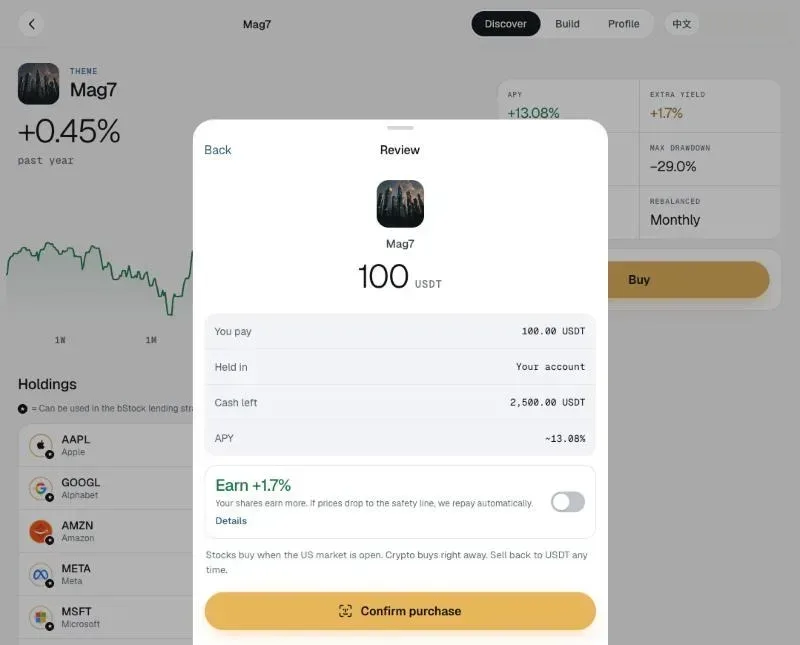

# Binance bStock vs CRE8: What Binance Does, Where CRE8 Differs

By CRE8 · November 23, 2026 · 6 min read

On Binance you can already buy bStock, its tokenized US stocks, with USDT, set up recurring buys and use bStock as margin collateral. CRE8 does something else: one USDT payment buys a whole basket of stocks and crypto at set weights, the assets sit in your own on-chain account, and an optional yield strategy lets your bStock earn extra. If you only want one or two stocks, Binance is all you need.

## What are bStock and a smart account?

bStock is a tokenized US stock on BNB Chain, issued by BTech Holdings, a Binance affiliate. One NVDA bStock corresponds to one Nvidia share held with a custodian and tracks its price. It isn't the same as holding shares at a broker: Binance states that "bStocks are not shares," and dividends are paid as extra tokens after a 30% US withholding tax, not as cash ([Binance Learn](https://www.binance.com/en/learn/bstocks)).

A smart account is an account on BNB Chain that belongs only to you. Your assets sit inside it where no one else can touch them. CRE8's automation can trade inside it for you, but moving money out takes your signature.

## What can you already do with bStock on Binance?

As of November 23, 2026, Binance offers four main bStock features:

| Feature | How it works |
|---|---|
| Spot trading | Buy one stock at a time with USDT, 24/7 (launched June 11, 2026) |
| Recurring buys | Set a recurring purchase for a single bStock in Convert or Buy/Sell (as reported by [Traders Union](https://tradersunion.com/news/brokers-news/show/2941539-binance-launches-automated-bstock-purchases/); check Binance's site for the actual terms) |
| Margin collateral | Since September 21, 2026, all eligible users can post bStock as collateral in Cross Margin and Portfolio Margin, valued at a discount ([Crypto Briefing](https://cryptobriefing.com/binance-bstocks-margin-collateral/)) |
| Withdraw to your wallet | Send bStock to a BNB Chain wallet, then trade it on PancakeSwap or lend and borrow on Venus or Lista yourself ([BNB Chain blog](https://bnbchain.org/en/blog/introducing-bstocks-on-bnb-chain-trade-24-7-with-zero-fees-deploy-across-defi-protocols-with-full-self-custody)) |

Binance also offers 7,000+ traditional US stocks and ETFs to users outside the US ([The Block](https://www.theblock.co/amp/post/403155/binance-adds-us-stocks-etfs-traders-outside-united-states-super-app-push)).

## When is Binance the better choice?

If you only want one or two stocks. Say you have 500 USDT and just want Nvidia: one order on Binance is the fastest way.

If you want a wide selection. Binance's traditional stock offering covers 7,000+ names, while CRE8's portfolios use the few dozen bStock tokens that have on-chain liquidity.

If you want leverage or derivatives. CRE8 is spot only and doesn't offer either.

## What does CRE8 do differently?

### One payment buys the whole basket

Buying five stocks on Binance means placing five orders and working out the weights yourself. On CRE8 you pick a portfolio, enter an amount, and the system buys every holding at its target weight in one go. With the Pelosi Portfolio, 100 USDT becomes 19 USDT each of Nvidia, Alphabet, Microsoft, Amazon and Intel, plus 5 USDT of Broadcom.

### The weights stay on target

After prices move, a 19% position can grow to 25%. CRE8 rebalances once a month, and also whenever any holding drifts more than 5 percentage points from its target. You don't have to remember to do it.

### Your assets are in your own account from day one

bStock bought on Binance sits in your exchange account by default. To hold it yourself, you have to withdraw it manually. With CRE8, everything you buy is in your smart account from the first purchase, visible on any block explorer, and only your signature can move it out.

### Your bStock can earn extra yield

On Binance, bStock as collateral is there to support trading. To earn interest with it, you'd withdraw it to a wallet, post it as collateral on a lending protocol, borrow, deposit what you borrowed, and keep an eye on it so you don't get liquidated.

CRE8's yield strategy turns those steps into one switch. When it's on, the system deposits the portfolio's shares in a lending market, borrows only a small part of the USDT the market would allow, and puts that USDT in a vault to earn interest. If prices fall to the safety line, it automatically repays part of the loan from the vault, and your shares aren't sold. The switch is off by default and you can turn it off any time. More on how it works in [how to earn yield on idle USDT and bStock](/blog/earn-yield-on-usdt-and-bstock).

### DCA money earns while it waits

DCA (dollar-cost averaging) means buying a fixed amount on a schedule. On CRE8, you deposit a lump sum into the portfolio's account up front, and it buys in installments daily, weekly, every two weeks or monthly. The money that hasn't been invested yet sits in a USDT vault earning interest, and you can withdraw it any time.

## What does 1,000 USDT look like on each?

Say you have 1,000 USDT and want the six stocks in the Pelosi Portfolio at its published weights: 19% each in Nvidia, Alphabet, Microsoft, Amazon and Intel, and 5% in Broadcom ([Pelosi Portfolio](https://cre8.finance/portfolios/pelosi)).

On Binance, you work out the amounts first: 190 USDT for each of the five 19% names and 50 USDT for Broadcom. Then you place six orders. A few months later, if Nvidia has run up and now makes up 25% of what you hold, you calculate how much to sell and what to buy with it, and place those orders too.

On CRE8, you pick the Pelosi Portfolio, enter 1,000 USDT and confirm once. The same six positions are bought in that one payment, through allowlisted on-chain venues (PancakeSwap, KyberSwap and OpenOcean). When Nvidia drifts from 19% to 25%, that's more than 5 points off target, so the portfolio rebalances back toward its weights without you doing anything. If you turned on the yield strategy at checkout, the shares also back a small USDT loan that earns in a vault.

On testnet this runs with free test USDT and simulated prices, so you can try the full flow without real money.

## How do Binance and CRE8 compare?

| | Binance | CRE8 |
|---|---|---|
| How you buy | One stock at a time | One payment for a whole basket |
| Where assets sit | Exchange account by default | Your own BNB Chain smart account |
| Rebalancing | Do it yourself | Monthly, plus whenever a holding drifts more than 5 points |
| Recurring buys | Yes, charged each period | Yes, deposit up front; uninvested money earns yield |
| Earning with bStock | Margin for trading; DIY lending after withdrawing | Yield strategy switch, auto-repays at the safety line |
| Selection | 7,000+ traditional US stocks, plus bStock | A few dozen bStock tokens with on-chain liquidity, plus BTC, BNB and more |
| Leverage and derivatives | Yes | No |
| Status | Live | BNB Chain testnet, no real money |

## What are the risks?

bStock isn't the share itself. You hold the issuer's instrument, and your rights depend on the issuer and the custodian. The issuer publishes a proof of collateral every day.

Prices can fall. The stocks and crypto in a portfolio can all drop. Model APY is a backtest that applies today's weights to historical prices, and it doesn't predict future returns.

The yield strategy is low risk, not zero risk. Lending market rates change, so the extra yield can shrink or disappear.

CRE8 runs on smart contracts, and contracts can have bugs. The contracts get an external audit before mainnet.

CRE8 is currently on BNB Chain testnet only, using free test USDT. There's no mainnet date yet.

## FAQ

**Can CRE8 take my money?**
No. Your assets are in your smart account. CRE8's automation can only trade inside it, and moving anything out takes your signature.

**What's the minimum?**
50 USDT per purchase, and at least 10 USDT per installment for DCA.

**Does CRE8 have a token?**
Not at present. CRE8 is also unrelated to the CRE8 Finance project on Solana.

**Can I buy when the US market is closed?**
Stock tokens only trade during US market hours. An order placed while the market is closed waits and goes through at the next open. Until then, your USDT stays in your account.

**Are there fees?**
Everything on testnet is free, and CRE8 pays the gas. Mainnet fees will be announced before launch.

## Next step

To see what a basket looks like, browse [all portfolios](https://cre8.finance/portfolios). Each one lists its holdings and weights.

---

Sources (accessed November 23, 2026): [BNB Chain blog](https://bnbchain.org/en/blog/introducing-bstocks-on-bnb-chain-trade-24-7-with-zero-fees-deploy-across-defi-protocols-with-full-self-custody), [DefiLlama Research](https://defillama.com/research/spotlight/stocks-onchain-how-binance-stocks-and-bstocks-cover-the-full-equities-spectrum), [Binance Learn: bStocks](https://www.binance.com/en/learn/bstocks), [Crypto Briefing](https://cryptobriefing.com/binance-bstocks-margin-collateral/), [Traders Union](https://tradersunion.com/news/brokers-news/show/2941539-binance-launches-automated-bstock-purchases/), [The Block](https://www.theblock.co/amp/post/403155/binance-adds-us-stocks-etfs-traders-outside-united-states-super-app-push).

This article explains how the two products differ. It is not investment advice.
