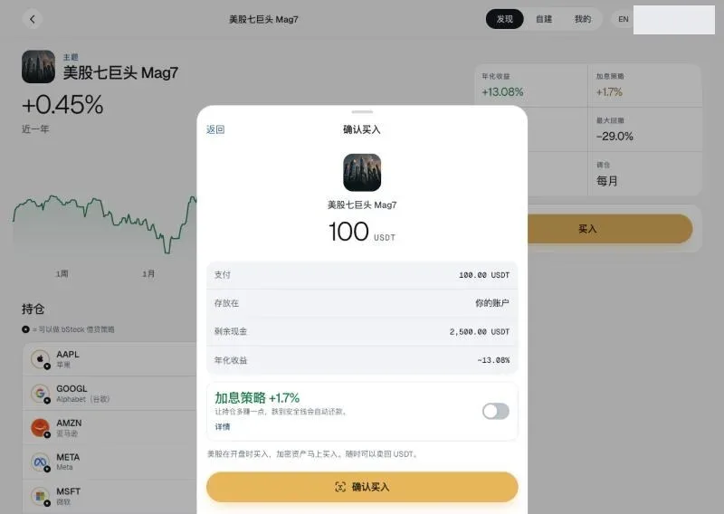

# 币安能买美股代币，为什么还要用 CRE8？差别在哪

作者：CRE8 · 2026 年 11 月 23 日 · 阅读约 6 分钟

在币安，你已经可以用 USDT 买美股代币 bStock，也能设定期买入、把 bStock 当保证金。CRE8 做的是另一件事：一笔 USDT 按比例买齐一整篮股票和加密资产，资产放在你自己的链上账户，还能开加息策略让 bStock 多赚一份收益。只想买一两只股票的话，直接用币安就够了。

## 先说清楚两个词

bStock 是币安关联公司 BTech Holdings 在 BNB Chain 上发行的美股代币。一枚 NVDA 的 bStock 对应托管机构里的一股英伟达，价格跟着正股走。它和你在券商名下持股不一样：币安官方写明「bStocks 不是股票」，分红先扣 30% 美国预扣税，再折成更多代币，不发现金（[Binance Learn](https://www.binance.com/en/learn/bstocks)）。

智能账户是 BNB Chain 上一个只属于你的账户。资产在里面，别人碰不到；CRE8 的自动化只能在里面帮你交易，钱要转出去，必须你本人签名。

## 在币安已经能做什么？

截至 2026 年 11 月 23 日，币安上和 bStock 有关的功能主要有四个：

| 功能 | 怎么用 |
|---|---|
| 交易所买卖 | 用 USDT 一只一只下单，24 小时都能交易（2026 年 6 月 11 日上线） |
| 定期买入 | 在「闪兑」或「买币」里给某一只 bStock 设定周期买入（据 [Traders Union](https://tradersunion.com/news/brokers-news/show/2941539-binance-launches-automated-bstock-purchases/) 报道，具体条款以币安官网为准） |
| 当保证金 | 2026 年 9 月 21 日起，所有合格用户都能把 bStock 当全仓杠杆和统一保证金账户的抵押品，按折扣计价（[Crypto Briefing](https://cryptobriefing.com/binance-bstocks-margin-collateral/)） |
| 提到自己的钱包 | 可以提到 BNB Chain 钱包，再自己去 PancakeSwap 交易、去 Venus 或 Lista 借贷（[BNB Chain 官方博客](https://bnbchain.org/en/blog/introducing-bstocks-on-bnb-chain-trade-24-7-with-zero-fees-deploy-across-defi-protocols-with-full-self-custody)） |

除此之外，币安还给美国以外的用户开了 7,000 多只传统美股和 ETF（[The Block](https://www.theblock.co/amp/post/403155/binance-adds-us-stocks-etfs-traders-outside-united-states-super-app-push)）。

## 什么情况直接用币安就好？

只想买一两只股票，比如手上 500 U 只想换成英伟达，在币安下一单最快。

想要很多选择。币安的传统美股有 7,000 多只，CRE8 的组合用的是有链上流动性的几十只 bStock。

要做杠杆或合约。CRE8 只做现货，不提供合约。

## CRE8 不一样的地方在哪？

### 一笔钱买齐一整篮

在币安买五只股票，就是下五单，比例自己算。在 CRE8 选一个组合，输入金额，系统按权重一次买齐。比如佩洛西持仓组合，100 USDT 会分成英伟达、谷歌、微软、亚马逊、英特尔各 19 USDT，博通 5 USDT。

### 比例会自己维持

股票涨跌之后，原本 19% 的仓位可能变成 25%。CRE8 每月调仓一次，任何一只偏离目标超过 5 个百分点也会调。你不用记得去调。

### 资产一开始就在你自己的账户

币安买的 bStock 默认放在交易所账户里。要自己保管，得手动提币。CRE8 买的资产从第一笔起就在你的智能账户，任何区块浏览器都查得到，转出只能你签名。

### 让 bStock 多赚一份收益

在币安，bStock 当保证金是给交易用的。想用它赚利息，得提到钱包、自己去借贷协议抵押、借款、存款，还要自己盯着别被清算。

CRE8 的加息策略把这几步变成一个开关。打开后，系统把股票存进借贷市场当抵押，只借市场允许额度的一小部分 USDT，存进 USDT 金库赚利息。价格跌到安全线，会自动用金库里的 USDT 还掉一部分借款，股票不卖。开关默认关闭，随时可以关。

### 定投的钱没买之前也在生息

在 CRE8 定投，是先存一笔进这个组合的账户，按天、周、两周或月分期买。还没轮到买的钱放在 USDT 金库里生息，随时可以领回。

## 放在一起比

| | 币安 | CRE8 |
|---|---|---|
| 怎么买 | 一只一只买 | 一笔钱买一整篮 |
| 资产放哪 | 默认在交易所账户 | 你自己的 BNB Chain 智能账户 |
| 自动调回比例 | 自己调 | 每月，加上偏离超过 5 个百分点时 |
| 定投 | 有，每期扣款 | 有，先存一笔，没买的部分生息 |
| bStock 赚收益 | 当保证金给交易用；自己提出去做借贷 | 加息策略一个开关，跌到安全线自动还款 |
| 可选股票 | 7,000 多只传统美股，加上 bStock | 几十只有链上流动性的 bStock，加 BTC、BNB 等 |
| 杠杆和合约 | 有 | 没有 |
| 目前状态 | 正式上线 | BNB Chain 测试网，不涉及真钱 |

## 有哪些风险？

bStock 不是股票本身。你持有的是发行方的凭证，权利取决于发行方和托管方；发行方每天公布抵押证明。

价格会跌。组合里的股票和加密资产都可能下跌，模型年化是用现在的权重套历史价格算出来的回测，不代表以后。

加息策略的风险低，但不是零。借贷市场的利率会变，收益可能变少甚至没有。

CRE8 用的是智能合约，合约有出错的可能。上主网前会做第三方审计。

CRE8 现在只在 BNB Chain 测试网上，用的是免费的测试 USDT，主网上线时间还没定。

## 常见问题

**CRE8 拿得走我的钱吗？**
拿不走。资产在你的智能账户里，CRE8 的自动化只能在账户里交易，转出必须你本人签名。

**最少投多少？**
每笔 50 USDT 起；定投每期最少 10 USDT。

**CRE8 有发币吗？**
目前没有。CRE8 和 Solana 上的 CRE8 Finance 也不是同一个项目。

**美股休市的时候能买吗？**
股票代币只在美股交易时段成交。休市时下的单会排队，下次开盘时成交，在那之前 USDT 一直在你的账户里。

**收费吗？**
测试网全部免费，gas 也由 CRE8 付。主网费率会在上线前公布。

## 下一步

想看看一篮子长什么样，可以先逛 [全部组合](https://cre8.finance/zh/portfolios)，每个组合都列了持仓和权重。

---

资料来源（查询日期 2026-11-23）：[BNB Chain 官方博客](https://bnbchain.org/en/blog/introducing-bstocks-on-bnb-chain-trade-24-7-with-zero-fees-deploy-across-defi-protocols-with-full-self-custody)、[DefiLlama Research](https://defillama.com/research/spotlight/stocks-onchain-how-binance-stocks-and-bstocks-cover-the-full-equities-spectrum)、[Crypto Briefing](https://cryptobriefing.com/binance-bstocks-margin-collateral/)、[Traders Union](https://tradersunion.com/news/brokers-news/show/2941539-binance-launches-automated-bstock-purchases/)、[The Block](https://www.theblock.co/amp/post/403155/binance-adds-us-stocks-etfs-traders-outside-united-states-super-app-push)。

本文只是说明产品差异，不是投资建议。
