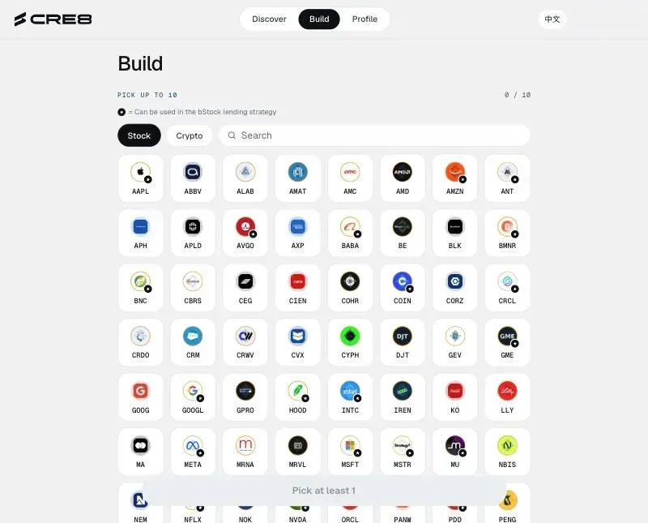
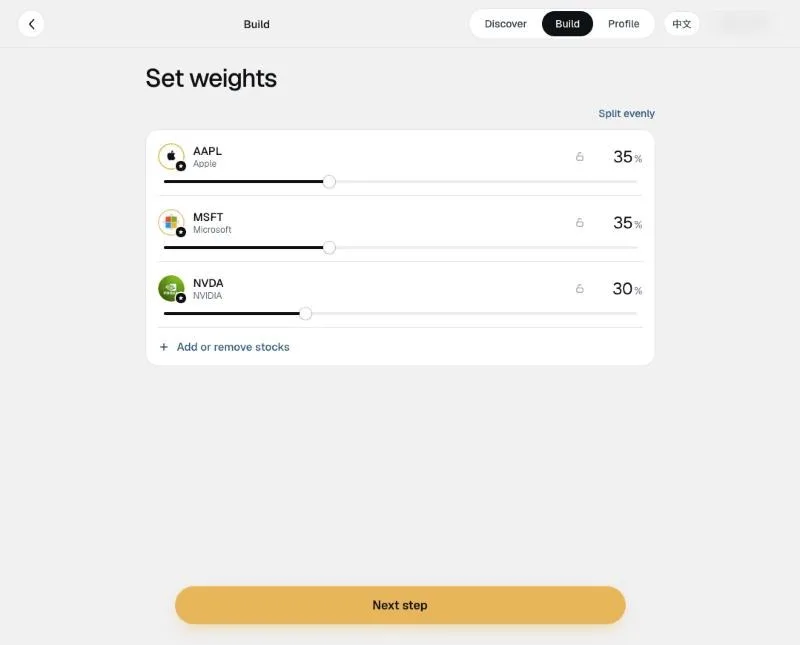
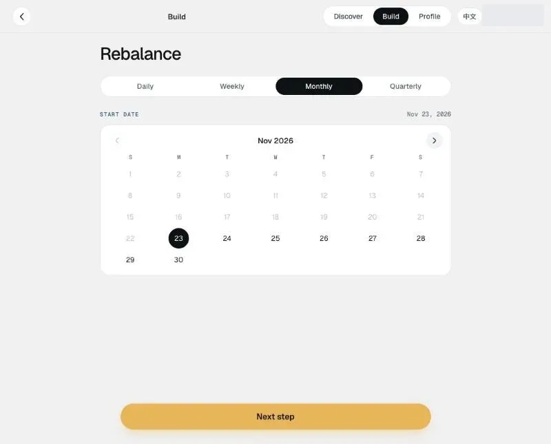
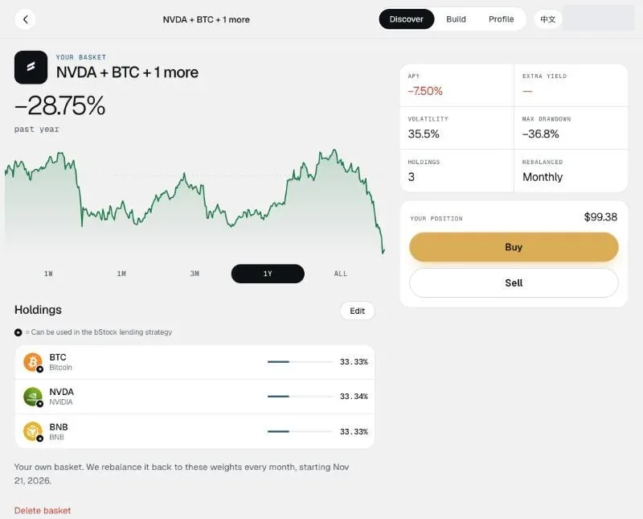

# Build Your Own Stock Portfolio on CRE8: Pick, Weight, Auto-Rebalance

By CRE8 · November 23, 2026 · 6 min read

Building your own portfolio on CRE8 means you choose the assets and the weight of each, buy the whole basket in one USDT payment, and CRE8 rebalances it back to your weights on the schedule you pick: daily, weekly, monthly or quarterly. Compared with buying stock tokens one by one on an exchange and rebalancing by hand, you skip the math and the repeat orders. Compared with buying an ETF through a broker, you set the list and the weights. CRE8 currently runs only on BNB Chain testnet, so no real money is involved.

## How is a custom portfolio different from a curated one?

The difference is who sets the list and the weights. Curated portfolios are CRE8's 21 ready-made baskets, grouped into people, themes and leveraged, with holdings and weights published on each portfolio page. In a custom portfolio, you pick the assets and set the weights.

The rebalancing rules differ too. Curated portfolios rebalance once a month, and whenever an asset drifts more than 5 percentage points from its target. A custom portfolio rebalances on the schedule you choose: daily, weekly, monthly or quarterly ([How CRE8 works](https://cre8.finance/how-it-works)).

Everything else is the same. You pay in USDT, the minimum is 50 USDT per purchase, and the assets sit in your own smart account.

## What do the key terms mean?

CRE8 (cre8.finance) is an app on BNB Chain for buying baskets of tokenized US stocks and crypto with USDT, held in your own smart account, with yield strategies that put your bStock to work.

A **smart account** is an on-chain account CRE8 opens for you on BNB Chain, owned by the wallet you sign in with. CRE8's automation can only trade inside it, and moving assets out takes your signature.

bStock is a tokenized US stock on BNB Chain issued by BTech Holdings, a Binance affiliate, each backed 1:1 by shares held with a custodian. Binance states that "bStocks are not shares" ([Binance Learn](https://www.binance.com/en/learn/bstocks)).

Rebalancing means pulling drifted weights back to target: trim what has grown, top up what has shrunk, until every asset is back at the weight you set.

## Why have someone else rebalance for you?

Because stocks move at different speeds, your weights will drift. You set NVIDIA at 40%, it rallies, and now it's 45% of the basket, a bigger bet than you planned.

Rebalancing by hand takes three steps: work out each holding's current weight, work out how much to sell and buy, then place each order. More holdings and more frequent rebalances mean more orders. CRE8 does all three on the schedule you choose.

## How do you build your own portfolio on CRE8?

Sign in first. The testnet needs an invite code: the first sign-in uses the code and your X account (after that, Google or email works too), and you claim free test USDT in the app. For the full first-time flow, see [how to buy your first portfolio on CRE8](/blog/how-to-buy-on-cre8).

Step 1: In the app, go to the build-your-own option and pick the stocks you want from the available assets.

Step 2: Set a weight for each asset, adding up to 100%.

Step 3: Choose how often to rebalance: daily, weekly, monthly or quarterly.

Step 4: Enter an amount and confirm. The minimum is 50 USDT per purchase. One confirmation buys every asset at the weights you set.

Trades go only through allowlisted on-chain venues (PancakeSwap, KyberSwap and OpenOcean), and each asset has a per-trade cap, so large orders are split into several trades. Stock tokens only trade during US market hours. An order placed while the market is closed waits for the next open, and your USDT stays in your own account until then ([How CRE8 works](https://cre8.finance/how-it-works)).

## How should you choose a rebalancing frequency?

More frequent rebalancing keeps your weights tighter but means more trades. Each rebalance is an on-chain trade, and venue pool fees and slippage apply ([How CRE8 works](https://cre8.finance/how-it-works)). The testnet is free and CRE8 pays the gas; mainnet fees will be announced before launch.

A rough way to think about it:

Daily keeps weights closest to your targets, with the most trades.

Weekly or monthly lets weights drift a little, with far fewer trades. CRE8's curated portfolios use monthly.

Quarterly has the fewest trades, and weights can drift further between rebalances. The more your assets diverge, the further they drift.

Rebalancing only restores your weights. It doesn't guarantee a gain, and the stock you trim may keep rising.

## What does it look like with 1,000 USDT?

Say you have 1,000 USDT and build a three-stock portfolio: NVIDIA 40%, Microsoft 30%, Apple 30%, rebalanced quarterly.

When you confirm, NVIDIA gets 400 USDT, Microsoft 300 USDT and Apple 300 USDT.

A quarter later, suppose Microsoft and Apple are flat and NVIDIA is up 25%, from 400 to 500 USDT. The basket is now 1,100 USDT: NVIDIA is 45.45%, Microsoft and Apple 27.27% each.

On the quarterly rebalance date, CRE8 brings NVIDIA back to 40%, or 440 USDT. It sells about 60 USDT of NVIDIA and adds 30 USDT each to Microsoft and Apple, which become 330 USDT, or 30%, each. This is a hypothetical that ignores fees and slippage.

Doing the same on an exchange means three orders to buy, then another round of math and three more orders every quarter. Binance's minimum per bStock is about $5 ([Binance Learn](https://www.binance.com/en/learn/bstocks)). With 10 holdings, each rebalance could take 10 orders.

Testnet prices are simulated, so these numbers only illustrate the flow.

## How does it compare with buying stocks one by one, or an ETF?

| | Buy one by one on an exchange, rebalance by hand | Buy an ETF at a broker | CRE8 curated portfolio | CRE8 custom portfolio (testnet) |
|---|---|---|---|---|
| Who sets the list and weights | You | The ETF issuer | CRE8, published on the portfolio page | You |
| Orders to buy a basket | One per stock | One per ETF | One USDT payment | One USDT payment |
| Rebalancing | You do the math and trades | Handled inside the ETF, rules vary | Monthly plus 5-point drift | Daily, weekly, monthly or quarterly, your choice |
| Pay directly with USDT | Yes | Most brokers don't take USDT; IBKR takes only USDC, PYUSD and RLUSD | Yes | Yes |
| What you own | Stock tokens | Actual ETF shares | Stock tokens and crypto | The assets you pick from the available list |
| Where assets sit | Exchange account | Brokerage account | Your own smart account | Your own smart account |
| Account opening / KYC | Yes (exchange account) | Yes (brokerage account) | Invite code on testnet | Invite code on testnet |
| Minimum | About $5 per stock | Varies by broker | 50 USDT per purchase | 50 USDT per purchase |
| Status | Live | Live | BNB Chain testnet | BNB Chain testnet |

Data checked November 23, 2026. Binance from [Binance Learn](https://www.binance.com/en/learn/bstocks); IBKR from [IBKR FAQ](https://www.interactivebrokers.com/support/faq/content/deposit-via-stablecoin-1331500535).

## When is another option a better fit?

If what you want is a standard index like the S&P 500 or Nasdaq-100, and you can open and fund a brokerage account, an ETF is the simplest route. You get real shares and the ETF handles rebalancing. CRE8 also has a ready-made [US Market portfolio](https://cre8.finance/portfolios/us-market) (QQQ and SPY at 50% each).

If a curated portfolio already matches what you want, just buy it; there's no need to build your own. See [how to buy a basket of US stocks with USDT](/blog/buy-us-stock-basket-with-usdt) for how they're weighted.

If you only want one or two stocks and don't care about weights, buying directly on Binance is fastest and needs no rebalancing.

If you need fills at any hour, Binance spot trades 24/7, while CRE8 trades stock tokens only during US market hours.

## What are the risks?

You set the list and weights, so you own the outcome. Two or three stocks in one industry will swing harder than a spread-out basket.

Prices can fall. Rebalancing keeps your weights on target; it doesn't protect you from a market-wide drop.

bStock is not a share. You hold the issuer's token, and dividends arrive as extra tokens after a 30% US withholding tax, not as cash ([Binance Learn](https://www.binance.com/en/learn/bstocks)).

On-chain liquidity varies. Buying a lot of a thinly traded token means slippage, a fill price worse than the quote; a large weight in such a token hits the same problem at each rebalance.

Smart contract risk applies. CRE8 runs on smart contracts that get a third-party audit before mainnet; that audit isn't done yet.

## FAQ

### Which assets can I choose?

Both US stock tokens and crypto, up to 10 per portfolio. The exact list is whatever the testnet app shows.

### What's the minimum?

50 USDT per purchase. An asset at 5% gets 2.50 USDT out of 50.

### Does a custom portfolio mix with my other portfolios?

No. Your cash and each portfolio's money are kept apart, and each portfolio rebalances on its own.

### Where does the money go when I sell?

Sell some or all of the portfolio back to USDT. It lands in your account, and you can withdraw it to any BNB Chain address.

### Does the testnet cost anything?

No. It's free, and CRE8 pays the gas. Mainnet fees will be announced before launch.

## Next step

Browse the curated portfolios first, then decide whether to build your own: [all portfolios](https://cre8.finance/portfolios).

---

Sources (checked November 23, 2026): [How CRE8 works](https://cre8.finance/how-it-works), [CRE8 llms.txt](https://cre8.finance/llms.txt), [CRE8 US Market portfolio](https://cre8.finance/portfolios/us-market), [Binance Learn: bStocks](https://www.binance.com/en/learn/bstocks), [IBKR stablecoin deposit FAQ](https://www.interactivebrokers.com/support/faq/content/deposit-via-stablecoin-1331500535).

This article explains how custom portfolios work on CRE8. It is not investment advice.
