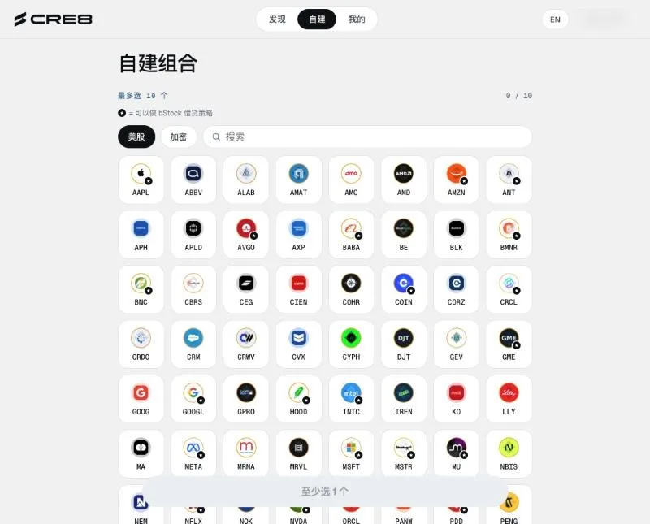
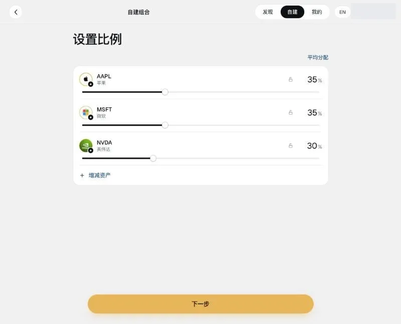
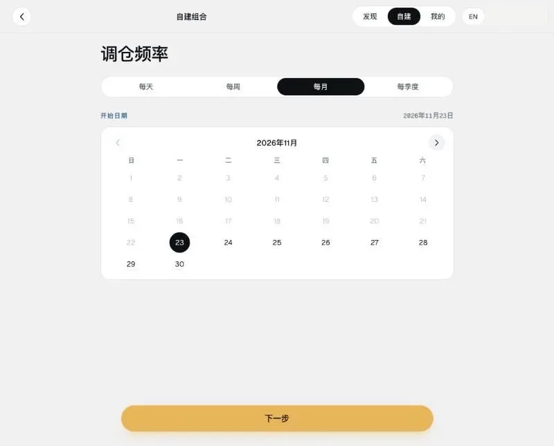
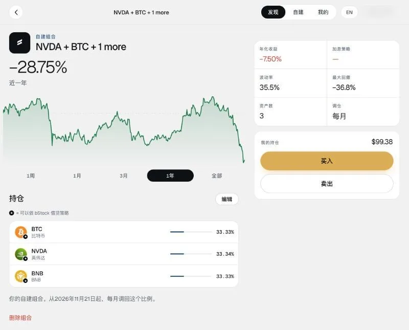

# 自己配组合：挑股票、定比例，CRE8 帮你调仓

作者：CRE8 · 2026 年 11 月 23 日 · 阅读约 7 分钟

在 CRE8 自己配组合，就是自己挑资产、自己定每个占多少，用 USDT 一笔买齐，之后 CRE8 按你选的频率帮你调回原来的比例。调仓频率可以选每天、每周、每月或每季。和在交易所一只一只买再手动调相比，省掉的是算比例和反复下单；和在券商买 ETF 相比，名单和比例由你定。CRE8 目前只在 BNB Chain 测试网，不涉及真钱。

## 自己配组合和精选组合差在哪？

差别在名单和比例由谁定。精选组合是 CRE8 配好的 21 个组合，分人物、主题、杠杆三类，成分和权重公开在组合页；自己配的组合由你挑资产、定比例。

调仓规则也不一样。精选组合每月调仓一次，另外任何资产偏离目标权重超过 5 个百分点时也会调；自己配的组合按你选的频率调，每天、每周、每月或每季四选一（[CRE8 使用指南](https://cre8.finance/zh/how-it-works)）。

其他部分一样：用 USDT 付款，每笔最少 50 USDT，资产放在你自己的智能账户里。

## 几个词先讲清楚

CRE8 是 BNB Chain 上的应用，用 USDT 一次买入美股代币和加密资产组合，资产放在你自己的智能账户里，还能开启加息策略，让 bStock 多赚一份收益。

**智能账户**是 CRE8 在 BNB Chain 上为你开的链上账户，所有人是你登录用的钱包。CRE8 的自动化只能在账户里交易，资产转出必须你本人签名。

bStock 是币安关联公司 BTech Holdings 在 BNB Chain 上发行的美股代币，每枚由托管的正股 1:1 支撑；币安官方写明「bStocks 不是股票」（[Binance Learn](https://www.binance.com/en/learn/bstocks)）。

再平衡（也叫调仓）是把跑掉的比例调回来：卖一点涨多的，补一点跌多的，让每个资产回到你定的比例。

## 为什么需要有人帮你调仓？

因为股票涨跌不一样，过一阵子比例一定会跑掉。你定的是英伟达 40%，它涨一波以后可能变成 45%，整个组合押在它身上的比重就比你原本想的大。

自己调要做三件事：算出每只现在占多少，算出要卖多少、补多少，再一只一只下单。持有的越多、调得越勤，下的单就越多。CRE8 把这三件事按你选的频率自动做掉。

## 怎么在 CRE8 自己配一个组合？

先登录。测试网第一次登录要用邀请码和 X 账号（之后也能用 Google 或邮箱），在应用里免费领测试 USDT。第一次用的完整流程见[怎么用 CRE8 买第一个组合](/zh/blog/how-to-buy-on-cre8)。

第一步，在应用里进入自己配组合的地方，从可选的资产里挑你要的股票。

第二步，给每个资产定比例，加起来是 100%。

第三步，选调仓频率：每天、每周、每月或每季。

第四步，输入金额后确认，每笔最少 50 USDT。确认一次，CRE8 按你定的比例把每个资产买齐。

交易只走白名单里的链上 DEX（PancakeSwap、KyberSwap、OpenOcean），每个资产有单笔上限，大单会自动拆成几笔。股票代币只在美股交易时段成交，休市时下的单会排队到下次开盘，在那之前 USDT 一直在你自己的账户里（[CRE8 使用指南](https://cre8.finance/zh/how-it-works)）。

## 调仓频率怎么选？

频率越高，比例贴得越紧，但交易次数也越多。每次调仓都是一笔链上交易，DEX 本身的池子手续费和滑点会算进去（[CRE8 使用指南](https://cre8.finance/zh/how-it-works)）。测试网全免费，gas 也由 CRE8 付；主网费率会在上线前公布。

大致可以这样想：

每天：比例最贴近你定的数字，交易次数也最多。

每周、每月：比例会跑一点，交易少很多。CRE8 的精选组合用的是每月。

每季：交易最少，两次调仓之间比例可能跑得比较远。几只资产涨跌差得越大，跑得越多。

调仓只是把比例调回来，不保证赚钱。卖掉的那只之后也可能继续涨。

## 用 1,000 U 走一遍是什么样？

假设你有 1,000 U，想配一个三只的组合：英伟达 40%、微软 30%、苹果 30%，每季调仓一次。

确认后，英伟达分到 400 U，微软 300 U，苹果 300 U。

过了一个季度，假设微软和苹果都没动，英伟达涨了 25%，从 400 U 变成 500 U。组合共 1,100 U，英伟达占 45.45%，微软、苹果各占 27.27%。

到了季度调仓日，CRE8 会把英伟达调回 40%，也就是 440 U，卖出约 60 U 的英伟达，微软、苹果各补 30 U，变成 330 U，各占 30%。上面没算手续费和滑点，只是假设的情况。

在交易所自己做同样的事，就是买的时候下 3 单，每季再自己算一次、下 3 单。币安单只 bStock 最低约 5 美元（[Binance Learn](https://www.binance.com/en/learn/bstocks)）。持有 10 只，每次调仓就可能要下 10 单。

测试网上的价格是模拟的，这些数字只用来说明流程。

## 和交易所逐只买、券商买 ETF 比，差在哪？

| | 交易所逐只买再手动调 | 券商买 ETF | CRE8 精选组合 | CRE8 自己配（测试网） |
|---|---|---|---|---|
| 名单和比例谁定 | 你自己 | ETF 发行方 | CRE8，组合页公开 | 你自己 |
| 买一篮要下几单 | 一只一单 | 一只 ETF 一单 | 一笔 USDT 买齐 | 一笔 USDT 买齐 |
| 调仓 | 自己算、自己下单 | ETF 内部调，规则看各 ETF | 每月＋偏离超过 5 个百分点 | 每天／每周／每月／每季，你选 |
| 能直接用 USDT 吗 | 能 | 多数券商不收 USDT，例如 IBKR 只收 USDC、PYUSD、RLUSD | 能 | 能 |
| 买到的是什么 | 股票代币 | 真 ETF 份额 | 股票代币和加密资产 | 你从可选资产里挑的 |
| 资产放哪 | 交易所账户 | 券商账户 | 自己的智能账户 | 自己的智能账户 |
| 要不要开户 KYC | 要（交易所账户） | 要（开户） | 测试网要邀请码 | 测试网要邀请码 |
| 最低金额 | 单只约 5 美元 | 视券商而定 | 每笔 50 USDT | 每笔 50 USDT |
| 目前状态 | 正式上线 | 正式上线 | BNB Chain 测试网 | BNB Chain 测试网 |

资料查询日：2026-11-23。币安见 [Binance Learn](https://www.binance.com/en/learn/bstocks)；IBKR 见 [IBKR FAQ](https://www.interactivebrokers.com/support/faq/content/deposit-via-stablecoin-1331500535)。

## 什么情况用别的方法就好？

想要的就是标普 500 或纳指 100 这种现成指数，又能开户入金：在券商买 ETF 最简单，拿到的是真份额，调仓由 ETF 自己做。CRE8 也有现成的[美股大盘组合](https://cre8.finance/zh/portfolios/us-market)（QQQ、SPY 各 50%）。

现成组合的名单你已经满意：直接买精选组合就好，不用自己配。几个精选组合怎么配，看[一次买一篮美股](/zh/blog/buy-us-stock-basket-with-usdt)。

只想买一两只、不在意比例：在币安直接下单最快，用不着调仓。

要 24 小时成交：币安现货 24 小时都能交易，CRE8 的股票代币只在美股交易时段成交。

中国大陆用户要注意：2026 年 5 月 22 日起，境外券商不能再为内地存量用户提供买入和入金，富途、老虎 6 月 12 日起照办（[证监会](https://www.csrc.gov.cn/csrc/c100028/c7634326/content.shtml)、[澎湃](https://www.thepaper.cn/newsDetail_forward_33309776)）。

## 有哪些风险？

名单和比例是你定的，结果也是你承担。只挑两三只、集中在一个行业，涨跌都会比分散的组合猛。

价格会跌。调仓维持的是比例，不会挡住整个市场下跌。

bStock 不是股票。你持有的是发行方的凭证，分红先扣 30% 美国预扣税再折成代币，不发现金（[Binance Learn](https://www.binance.com/en/learn/bstocks)）。

链上池子有深有浅。池子浅的股票买多了会有滑点，也就是成交价比报价差一些；比例定得太高，调仓时也会遇到同样的问题。

智能合约风险。CRE8 用智能合约运作，上主网前会做第三方合约审计，目前还没完成。

## 常见问题

### 能选哪些资产？

美股和加密资产都能选，一个组合最多 10 个。具体有哪些，以测试网应用里列出的为准。

### 最少要投多少？

每笔买入 50 USDT。比例 5% 的资产，50 U 里分到 2.5 U。

### 自己配的组合会混到别的组合吗？

不会。你的现金和每个组合的资金都分开，各自调仓。

### 卖出以后钱去哪？

组合可以部分或全部卖回 USDT，钱回到你的账户，再提到任意 BNB Chain 地址。

### 测试网收费吗？

全免费，gas 也由 CRE8 付。主网费率会在上线前公布。

## 下一步

想先看看 CRE8 有哪些现成组合，再决定要不要自己配：[全部组合](https://cre8.finance/zh/portfolios)。

---

资料来源（查询日期 2026-11-23）：[CRE8 使用指南](https://cre8.finance/zh/how-it-works)、[CRE8 llms.txt](https://cre8.finance/llms.txt)、[CRE8 美股大盘组合页](https://cre8.finance/zh/portfolios/us-market)、[Binance Learn：bStocks](https://www.binance.com/en/learn/bstocks)、[IBKR 稳定币入金 FAQ](https://www.interactivebrokers.com/support/faq/content/deposit-via-stablecoin-1331500535)、[中国证监会](https://www.csrc.gov.cn/csrc/c100028/c7634326/content.shtml)、[澎湃](https://www.thepaper.cn/newsDetail_forward_33309776)。

本文只说明自己配组合怎么用，不是投资建议。
