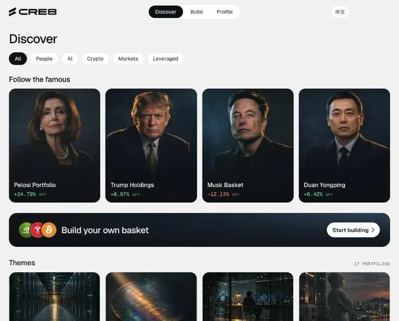

# CRE8 Portfolios Explained: People, Themes and Leveraged

By CRE8 · November 23, 2026 · About 9 minutes

CRE8 has 21 ready-made portfolios in three groups: 4 people portfolios, 15 theme portfolios and 2 leveraged portfolios. Most people portfolios are built from public filings that arrive weeks to months late; theme portfolios hold stocks and crypto picked for a theme and bought on-chain; each leveraged portfolio holds a single 3x ETF token that resets daily, which makes them the riskiest. Choose by the exposure you want and the swings you can live with, not by which backtest number is highest.

## What do the key terms mean?

A portfolio is a basket of assets at fixed target weights. On CRE8 you pick one, enter an amount, and one USDT payment buys every asset at its weight. The minimum is 50 USDT per purchase ([CRE8 How it works](https://cre8.finance/how-it-works)).

A weight is each asset's share of the portfolio. A 19% weight means 19 USDT of every 100 USDT goes into that asset.

The US stocks are held as bStock, tokenized US stocks on BNB Chain issued by BTech Holdings, a Binance affiliate. Each token is backed 1:1 by shares held with a custodian. Binance states that bStocks are not shares ([Binance Learn](https://www.binance.com/en/learn/bstocks)).

Model APY is what CRE8 gets by running a portfolio's current target weights through daily closing prices from November 22, 2024 to November 22, 2026, compounded and annualized. It's a backtest, not a track record.

## How do the three groups differ?

People portfolios follow one person's disclosed holdings, theme portfolios follow an idea, and leveraged portfolios are a single 3x ETF token.

| | People | Themes | Leveraged |
|---|---|---|---|
| How many | 4 | 15 | 2 |
| Where the holdings come from | Public filings (except Musk) | CRE8 picks by theme, with enough on-chain liquidity | One 3x leveraged ETF token |
| Data delay | Weeks to months | Not applicable | Not applicable |
| Number of assets | 4 to 8 | 2 to 7 | 1 |
| Automatic rebalancing | Monthly, plus 5-point drift | Same | Single asset, nothing to rebalance |
| DCA (gradual buying) | Yes | Yes | No, one-time purchase only |
| Yield strategy | Available | Available | Not offered |
| Main risk | Concentrated; filings are delayed | Concentrated; some hold crypto | High risk; you can lose most of what you put in |

Sources: each portfolio page and [CRE8 llms.txt](https://cre8.finance/llms.txt), checked November 23, 2026.

## Where do the people portfolios get their holdings, and how late is the data?

There are four people portfolios. Three are built from public filings; the Musk Basket isn't. The "Where the list comes from" text below is quoted from each portfolio page, the weights come from [llms.txt](https://cre8.finance/llms.txt), and every model APY is a backtest as of November 22, 2026.

### Pelosi Portfolio

From the portfolio page: "Nancy Pelosi's household reports its stock trades to the US House of Representatives in Periodic Transaction Reports, usually 30 to 45 days after the trade. This portfolio is built from those filings. Many of the trades are call options. The portfolio holds the underlying shares instead. The filings give dollar ranges, not exact amounts, so CRE8 sets the weights" ([Pelosi Portfolio](https://cre8.finance/portfolios/pelosi)).

Holdings: NVIDIA, Alphabet, Microsoft, Amazon and Intel at 19% each, Broadcom at 5%. Model APY (backtest): +24.8%. For how to read the filings and what the delay means, see [How to copy the Pelosi portfolio with crypto](/blog/copy-pelosi-portfolio-with-crypto).

### Trump Holdings

From the portfolio page: "Built from the financial disclosures Donald Trump files with the US Office of Government Ethics. The filings list holdings in value ranges, without share counts, and arrive weeks to months after the trades. Because the amounts are ranges, the portfolio holds the large US stocks that appear in the filings in equal weights. Companies he owns or runs, such as Trump Media, are left out" ([Trump Holdings](https://cre8.finance/portfolios/trump)).

Holdings: NVIDIA, Apple, Microsoft, Amazon, Meta, Tesla, Alphabet and Netflix at 12.5% each. Model APY (backtest): +9.0%.

### Duan Yongping

From the portfolio page: "Built from the quarterly 13F filings of H&H International Investment, the firm that reports Duan Yongping's US stock holdings to the SEC. 13F filings come out up to 45 days after each quarter ends. The portfolio holds the names from those filings that can be bought on-chain, in equal weights. Berkshire Hathaway, a large holding in the filing, is left out because there's no on-chain market deep enough to buy it" ([Duan Yongping](https://cre8.finance/portfolios/duan)).

Holdings: Apple, PDD Holdings, NVIDIA and Tesla at 25% each. Model APY (backtest): +6.4%.

### Musk Basket

From the portfolio page: "This one isn't a disclosure portfolio. Elon Musk doesn't publish a personal stock list, so the basket holds the listed companies he runs, Tesla and SpaceX, plus bitcoin, which both companies hold on their balance sheets, and a small position in Dogecoin" ([Musk Basket](https://cre8.finance/portfolios/musk)).

Holdings: Tesla 31.66%, SpaceX 31.67%, bitcoin 31.67%, Dogecoin 5%. Model APY (backtest): −12.1%. SpaceX only enters the backtest from July 12, 2026.

The three filing-based portfolios reflect what has been disclosed, not what anyone holds today.

## Which theme portfolios are there?

There are 15 theme portfolios. Each page states the method: CRE8 picks companies that fit the theme and can be bought on-chain with enough liquidity. Names with deep markets form the core, and names with thinner markets get about 5% each.

The table groups them by subject, not by return. Weights come from [llms.txt](https://cre8.finance/llms.txt); model APY is a backtest as of November 22, 2026.

| Portfolio | In one line | Holdings and weights | Model APY (backtest) |
|---|---|---|---|
| [AI Chips](https://cre8.finance/portfolios/ai-chips) | Chipmakers behind AI computing | NVIDIA, TSMC, Intel, SK hynix 21.25% each; Broadcom, Marvell, Penguin Solutions 5% each | +61.4% |
| [AI Memory](https://cre8.finance/portfolios/ai-memory) | Memory and storage for AI data centers | SK hynix 33.33%, Micron 33.34%, SanDisk 33.33% | +228.2% |
| [Korea Semis](https://cre8.finance/portfolios/korea-semiconductors) | SK hynix plus a South Korea market fund | SK hynix 50%, EWY 50% | +111.0% |
| [AI Model Makers](https://cre8.finance/portfolios/ai-models) | Companies behind leading AI models | Anthropic 16.67%, Amazon 16.67%, Alphabet 16.67%, Microsoft 16.66%, SpaceX 16.66%, Meta 16.67% | +14.5% |
| [New Giants](https://cre8.finance/portfolios/new-giants) | Two of the largest new names on the market | SpaceX 50%, Anthropic 50% | −24.3% |
| [Mag7](https://cre8.finance/portfolios/mag7) | Seven big US tech companies, equal weights | Apple 14.29%, Microsoft 14.28%, Alphabet 14.29%, Amazon 14.29%, NVIDIA 14.28%, Meta 14.29%, Tesla 14.28% | +13.1% |
| [Everyday Brands](https://cre8.finance/portfolios/everyday) | Companies people use every day | Apple 15.84%, Amazon 15.84%, Netflix 15.83%, Alphabet 15.83%, Meta 15.83%, Microsoft 15.83%, Reddit 5% | +9.6% |
| [US Market](https://cre8.finance/portfolios/us-market) | Nasdaq-100 plus S&P 500 | QQQ 50%, SPY 50% | +9.6% |
| [China Tech](https://cre8.finance/portfolios/china) | Alibaba and PDD Holdings | Alibaba 50%, PDD 50% | −2.4% |
| [Meme Stocks](https://cre8.finance/portfolios/meme) | Retail favorites | GameStop 45%, Dogecoin 45%, AMC 5%, Trump Media 5% | −33.9% |
| [BNB Ecosystem](https://cre8.finance/portfolios/bnb) | BNB plus a listed company that holds BNB | BNB 50%, BNC 50% | +17.4% |
| [Bitcoin Plus](https://cre8.finance/portfolios/bitcoin-plus) | Bitcoin plus two companies tied to it | Bitcoin 33.34%, Strategy 33.33%, Coinbase 33.33% | −38.5% |
| [Crypto Treasuries](https://cre8.finance/portfolios/crypto-treasuries) | Listed companies holding crypto | Strategy 31.66%, BitMine 31.67%, BNC 31.67%, Cypherpunk 5% | −18.4% |
| [Crypto Infrastructure](https://cre8.finance/portfolios/crypto-infrastructure) | Companies that move money in crypto | Circle 33.33%, Coinbase 33.34%, Robinhood 33.33% | −15.9% |
| [Gold + Bitcoin](https://cre8.finance/portfolios/gold-bitcoin) | Tokenized gold and bitcoin | XAUt 50%, Bitcoin 50% | −2.8% |

The first eight are mostly US tech and the broad market, China Tech and Meme Stocks stand on their own, and the last five are tied to crypto. Crypto usually swings far more than stocks.

## What does a daily-reset 3x portfolio mean?

There are two leveraged portfolios: [3x Semiconductors](https://cre8.finance/portfolios/soxl) holds 100% SOXL, and [3x Nasdaq](https://cre8.finance/portfolios/tqqq) holds 100% TQQQ. Both are leveraged ETFs that aim for three times their index's move on a single day.

Daily reset means the 3x applies to one day only. The next day starts over from the new price. Over weeks or months, the result can be far from three times what the index did.

The numbers make it clear. Say an index rises 10% one day and falls 10% the next: 100 becomes 110, then 99, a 1% loss. The 3x product rises 30% and then falls 30%: 100 becomes 130, then 91, a 9% loss. That's 6 points worse than three times the index's loss. In a choppy market, the gap keeps growing.

The portfolio pages show the same thing. As of November 22, 2026, 3x Semiconductors returned −72.2% over the last 90 days in the model, and 3x Nasdaq returned −40.2%. Their model APYs (backtest) are +4.6% and +3.5%. Same portfolio, different time window, very different number.

The pages say to put in only money you can afford to lose most of. Leveraged portfolios are bought in one go, with no gradual buying and no yield strategy.

## How should you read model APY?

Model APY is a backtest: today's weights run through the last two years of prices. It answers "what if I had bought these weights two years ago?" and says nothing about what comes next.

Short and long windows can point in opposite directions. AI Memory has a model APY (backtest) of +228.2%, yet its page shows a −37.3% model return over the last 90 days, as of November 22, 2026. The Pelosi Portfolio's model APY is +24.8%, and its last 30 days are −21.2%.

That's why the table above is grouped by subject, not sorted by return. Portfolios with the biggest backtests tend to be the ones concentrated in a few volatile names.

## What does 500 USDT across three portfolios look like?

Say you use 500 test USDT on testnet and split it three ways: 200 into AI Chips, 200 into US Market and 100 into 3x Nasdaq.

| Portfolio | Amount | What each asset gets |
|---|---|---|
| AI Chips | 200 USDT | NVIDIA, TSMC, Intel, SK hynix 42.50 USDT each; Broadcom, Marvell, Penguin Solutions 10 USDT each |
| US Market | 200 USDT | QQQ 100 USDT, SPY 100 USDT |
| 3x Nasdaq | 100 USDT | TQQQ 100 USDT |

That's three purchases, each at or above the 50 USDT minimum. Afterward, AI Chips and US Market rebalance monthly, and sooner if any asset drifts more than 5 points from target.

Now the risk side. Applying 3x Nasdaq's 90-day model return of −40.2%, the 100 USDT would be worth about 59.80 USDT. That's an illustration from past model numbers, not a forecast. Testnet prices are simulated, and no real money is involved.

## How do you pick one for your situation?

You want the US market as a whole, not a single bet: US Market holds two index ETFs, the Nasdaq-100 and the S&P 500, which together cover hundreds of companies.

You want to follow someone's disclosed holdings: look at the people portfolios, and read "Where the list comes from" first so you know how late the data is and who set the weights.

You have a view on a theme: look at the theme portfolios, and keep in mind that each holds only 2 to 7 assets.

You can afford to lose most of the money and want amplified short-term moves: only then consider a leveraged portfolio, and keep the amount small.

None of the 21 fit: build your own with the assets and weights you choose. CRE8 rebalances it daily, weekly, monthly or quarterly, as you prefer.

## When is another option the better fit?

You only want one or two stocks. If all you want is NVIDIA, buying that bStock on Binance is faster than buying a basket.

You want to judge each filing yourself, follow only fresh buys, or copy the options too. CRE8's people portfolios follow a fixed method and you can't change their weights, so reading the filings and placing your own trades fits better.

You want to hold leverage for the long run. Daily reset means long-term results can drift far from what you'd expect, so 3x products don't suit buy-and-forget.

You want real shares with full shareholder rights, or the full range of ETFs. An overseas brokerage account fits better.

## What are the risks?

Prices go down as well as up, and you can lose money. Each portfolio holds 1 to 8 assets, so they're concentrated, and the ones with crypto usually swing more.

Filings are delayed. People portfolios reflect what has been disclosed, weeks to months late.

Leveraged portfolios carry the most risk. The daily reset compounds losses in choppy markets, and you can lose most of your money.

bStock is not a share. It's issued by BTech Holdings, and your rights depend on the issuer and custodian.

On-chain markets vary in depth. Stock tokens only trade during US market hours, and some pools are thin, so large orders move the price.

CRE8 is on BNB Chain testnet only. Prices are simulated, no real money is involved, and there's no mainnet date yet.

## FAQ

**Will the 21 portfolios change?**
Yes. Holdings and weights follow the portfolio pages on cre8.finance; this post is a snapshot from November 23, 2026.

**Do the people portfolios represent those people?**
No. They're built from public information and aren't affiliated with Pelosi, Trump, Duan Yongping or Musk.

**Is a higher model APY better?**
Not necessarily. It's a backtest, and short-term results can run the other way: AI Memory's model APY is +228.2%, but its last 90 days are −37.3%.

**Can I DCA into a leveraged portfolio or turn on the yield strategy?**
No to both. Leveraged portfolios are one-time purchases with no yield strategy.

**What's the minimum?**
50 USDT per purchase for any portfolio.

## Next step

Open the one you're curious about from [All portfolios](https://cre8.finance/portfolios) to see its full holdings, backtest method and model returns by period.

---

Further reading: [What is CRE8?](/blog/what-is-cre8), [How to buy a basket of US stocks with USDT](/blog/buy-us-stock-basket-with-usdt), [Build your own portfolio on CRE8](/blog/build-your-own-portfolio)

Sources (checked November 23, 2026): [CRE8 llms.txt](https://cre8.finance/llms.txt), [CRE8 All portfolios](https://cre8.finance/portfolios) (including each portfolio page), [CRE8 How it works](https://cre8.finance/how-it-works), [Binance Learn: bStocks](https://www.binance.com/en/learn/bstocks).

This article is not investment advice.
