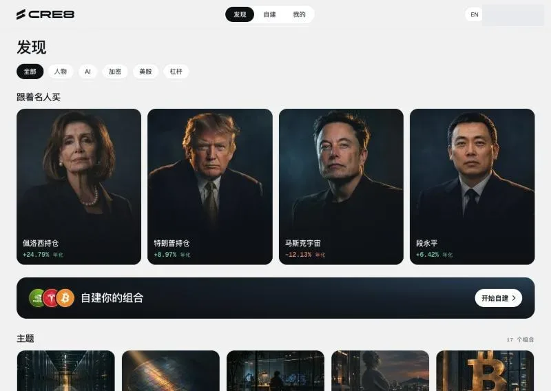

# CRE8 的组合怎么选：人物、主题、杠杆各是什么

作者：CRE8 · 2026 年 11 月 23 日 · 阅读约 9 分钟

CRE8 有 21 个精选组合，分三类：人物组合 4 个，主题组合 15 个，杠杆组合 2 个。人物组合大多按公开申报整理，会晚几周到几个月；主题组合是按题材挑出链上买得到的股票和加密资产；杠杆组合各持有一只每天重置的 3 倍杠杆 ETF 代币，风险最高。挑组合先看自己想要哪种暴露、能承受多大波动，不要看模型年化排名。

## 先说清楚几个词

组合是一篮按固定比例配好的资产。你在 CRE8 选一个组合、输入金额，一笔 USDT 会按目标权重把每个资产买齐，每笔 50 USDT 起（[CRE8 使用指南](https://cre8.finance/zh/how-it-works)）。

权重是每个资产占组合的比例。比如权重 19%，100 USDT 里就有 19 USDT 买这只股票。

美股部分以 bStock 持有。bStock 是币安关联公司 BTech Holdings 在 BNB Chain 上发行的美股代币，每枚由托管的正股 1:1 支撑。币安官方写明「bStocks 不是股票」（[Binance Learn](https://www.binance.com/en/learn/bstocks)）。

模型年化是 CRE8 用组合现在的目标权重，套上 2024 年 11 月 22 日到 2026 年 11 月 22 日的每日收盘价，算出来的复利年化收益。它是回测，不是实盘战绩。

## 三类组合有什么不同？

一句话：人物组合跟的是某个人公开的持仓，主题组合跟的是一个题材，杠杆组合是放大 3 倍的单一 ETF 代币。

| | 人物组合 | 主题组合 | 杠杆组合 |
|---|---|---|---|
| 数量 | 4 个 | 15 个 | 2 个 |
| 成分怎么来 | 公开申报（马斯克除外） | CRE8 按题材挑，要求链上流动性够 | 一只 3 倍杠杆 ETF 代币 |
| 数据延迟 | 几周到几个月 | 不适用 | 不适用 |
| 资产数 | 4 到 8 个 | 2 到 7 个 | 1 个 |
| 自动调仓 | 每月，加上偏离 5 个百分点时 | 同左 | 单一资产，不需要调比例 |
| 定投（分批买入） | 可以 | 可以 | 不支持，只能一次买入 |
| 加息策略 | 可以开 | 可以开 | 不提供 |
| 风险 | 集中度高，申报有延迟 | 集中度高，部分含加密资产 | 高风险，可能亏掉大部分本金 |

资料来源：各组合页与 [CRE8 llms.txt](https://cre8.finance/llms.txt)，查询日期 2026-11-23。

## 人物组合：持仓从哪来、晚多久？

人物组合有 4 个。前三个按公开申报整理，第四个马斯克不是跟申报的。下面「持仓从哪来」引自各组合页原文，权重引自 [llms.txt](https://cre8.finance/llms.txt)，模型年化都是回测，截至 2026-11-22。

### 佩洛西持仓

组合页原文：「佩洛西家族会通过“定期交易报告”（PTR）向美国众议院申报股票交易，一般在成交后 30–45 天公开。这个组合就是按这些申报整理的。她很多笔交易买的是看涨期权，组合里直接持有对应的正股。申报只披露金额区间、没有具体数字，所以权重由 CRE8 设定」（[佩洛西持仓](https://cre8.finance/zh/portfolios/pelosi)）。

持仓：英伟达、谷歌、微软、亚马逊、英特尔各 19%，博通 5%。模型年化（回测）+24.8%。申报怎么查、延迟怎么影响结果，另见 [怎么用加密货币跟投佩洛西持仓](/zh/blog/copy-pelosi-portfolio-with-crypto)。

### 特朗普持仓

组合页原文：「按特朗普向美国政府道德办公室（OGE）提交的财务申报整理。申报只列持仓的金额区间、不写股数，而且比实际交易晚几周到几个月。因为只有区间，组合对申报里出现的美股大盘股做等权配置，不纳入他本人持有或经营的公司（比如特朗普媒体）」（[特朗普持仓](https://cre8.finance/zh/portfolios/trump)）。

持仓：英伟达、苹果、微软、亚马逊、Meta、特斯拉、谷歌、奈飞各 12.5%。模型年化（回测）+9.0%。

### 段永平持仓

组合页原文：「按 H&H International Investment 每季度提交给美国证监会（SEC）的 13F 报告整理，段永平的美股持仓就是通过这家机构申报的。13F 最晚在每季度结束后 45 天公开。组合持有报告里能在链上买到的股票，等权配置。报告里仓位很重的伯克希尔·哈撒韦没有纳入，因为链上还没有足够深的池子能买」（[段永平持仓](https://cre8.finance/zh/portfolios/duan)）。

持仓：苹果、拼多多、英伟达、特斯拉各 25%。模型年化（回测）+6.4%。

### 马斯克宇宙

组合页原文：「这一个不是跟申报的。马斯克没有公开个人持股清单，所以组合放的是他掌舵的两家公司特斯拉和 SpaceX，加上两家公司账上都有的比特币，再配一点狗狗币」（[马斯克宇宙](https://cre8.finance/zh/portfolios/musk)）。

持仓：特斯拉 31.66%、SpaceX 31.67%、比特币 31.67%、狗狗币 5%。模型年化（回测）−12.1%。SpaceX 从 2026 年 7 月 12 日起才计入回测。

三个跟申报的组合，反映的都是已经公开的持仓，不是对方此刻手里的仓位。

## 主题组合有哪些？

主题组合有 15 个。组合页写明了挑法：CRE8 挑选贴合主题、并且能在链上以足够流动性买到的标的，池子深的放核心仓位，池子浅的每只约占 5%。

下表按题材分组，不按收益排序。权重来自 [llms.txt](https://cre8.finance/llms.txt)，模型年化是回测，截至 2026-11-22。

| 组合 | 一句话 | 持仓与权重 | 模型年化（回测） |
|---|---|---|---|
| [AI 芯片](https://cre8.finance/zh/portfolios/ai-chips) | AI 算力背后的芯片公司 | 英伟达、台积电、英特尔、SK 海力士各 21.25%；博通、Marvell、Penguin Solutions 各 5% | +61.4% |
| [AI 存储](https://cre8.finance/zh/portfolios/ai-memory) | AI 数据中心用的存储芯片 | SK 海力士 33.33%、美光 33.34%、闪迪 33.33% | +228.2% |
| [韩国半导体](https://cre8.finance/zh/portfolios/korea-semiconductors) | SK 海力士加韩国大盘 ETF | SK 海力士 50%、EWY 50% | +111.0% |
| [AI 大模型](https://cre8.finance/zh/portfolios/ai-models) | 做头部 AI 大模型的公司 | Anthropic 16.67%、亚马逊 16.67%、谷歌 16.67%、微软 16.66%、SpaceX 16.66%、Meta 16.67% | +14.5% |
| [新晋巨头](https://cre8.finance/zh/portfolios/new-giants) | 刚上市的两家巨头 | SpaceX 50%、Anthropic 50% | −24.3% |
| [美股七巨头](https://cre8.finance/zh/portfolios/mag7) | 七家大型科技公司等权 | 苹果 14.29%、微软 14.28%、谷歌 14.29%、亚马逊 14.29%、英伟达 14.28%、Meta 14.29%、特斯拉 14.28% | +13.1% |
| [天天在用](https://cre8.finance/zh/portfolios/everyday) | 每天都在用的公司 | 苹果 15.84%、亚马逊 15.84%、奈飞 15.83%、谷歌 15.83%、Meta 15.83%、微软 15.83%、Reddit 5% | +9.6% |
| [美股大盘](https://cre8.finance/zh/portfolios/us-market) | 纳指 100 加标普 500 | QQQ 50%、SPY 50% | +9.6% |
| [中概电商](https://cre8.finance/zh/portfolios/china) | 阿里巴巴和拼多多 | 阿里巴巴 50%、拼多多 50% | −2.4% |
| [迷因股](https://cre8.finance/zh/portfolios/meme) | 散户最爱 | GameStop 45%、狗狗币 45%、AMC 5%、特朗普媒体 5% | −33.9% |
| [BNB 生态](https://cre8.finance/zh/portfolios/bnb) | BNB 加囤 BNB 的上市公司 | BNB 50%、BNC 50% | +17.4% |
| [比特币加强版](https://cre8.finance/zh/portfolios/bitcoin-plus) | 比特币加两家相关上市公司 | 比特币 33.34%、微策略 33.33%、Coinbase 33.33% | −38.5% |
| [囤币上市公司](https://cre8.finance/zh/portfolios/crypto-treasuries) | 账上放加密资产的上市公司 | 微策略 31.66%、BitMine 31.67%、BNC 31.67%、Cypherpunk 5% | −18.4% |
| [加密基建](https://cre8.finance/zh/portfolios/crypto-infrastructure) | 加密世界的资金通道 | Circle 33.33%、Coinbase 33.34%、Robinhood 33.33% | −15.9% |
| [黄金+比特币](https://cre8.finance/zh/portfolios/gold-bitcoin) | 黄金代币加比特币 | XAUt 50%、比特币 50% | −2.8% |

前 8 个以美股科技和大盘为主，中概和迷因股是单独的题材，后 5 个和加密资产有关。加密资产的波动通常比股票大得多。

## 杠杆组合：每天重置的 3 倍是什么意思？

杠杆组合有 2 个：[3 倍半导体](https://cre8.finance/zh/portfolios/soxl) 持有 SOXL 100%，[3 倍纳指](https://cre8.finance/zh/portfolios/tqqq) 持有 TQQQ 100%。两只都是杠杆 ETF，每天追求指数 3 倍的涨跌。

每天重置的意思是：3 倍只对「一天」成立，第二天从新的价格重新算。拉长到几周、几个月，结果可能和「指数涨跌的 3 倍」差很远。

用数字看最清楚。指数第一天涨 10%、第二天跌 10%，100 变 110 再变 99，两天亏 1%。3 倍产品第一天涨 30%、第二天跌 30%，100 变 130 再变 91，两天亏 9%，比「指数亏 1% 的 3 倍」多亏了 6 个点。涨涨跌跌的震荡行情里，这种差距会越滚越大。

组合页的模型数字也说明了这点。3 倍半导体近 90 天模型收益 −72.2%，3 倍纳指近 90 天 −40.2%，截至 2026-11-22。两者的模型年化（回测）分别是 +4.6% 和 +3.5%，同一个组合，看的时间段不同，数字差得很远。

组合页写明「只适合能承受亏掉大部分本金的人」。杠杆组合只能一次性买入，不支持分批买入，也不提供加息策略。

## 模型年化怎么看？

模型年化是回测：用今天的权重，套上过去两年的价格算出来的。它回答的是「如果两年前就按这个比例买，会怎样」，不回答「以后会怎样」。

同一个组合，短期和长期可以完全相反。AI 存储的模型年化（回测）是 +228.2%，但组合页显示它近 90 天的模型收益是 −37.3%，截至 2026-11-22。佩洛西持仓模型年化 +24.8%，近 30 天是 −21.2%。

所以本文的表按题材分组，不按收益排序。回测高的组合，往往也是集中在少数几只、波动大的组合。

## 500 USDT 分在三个组合里是什么样？

假设你在测试网用 500 测试 USDT，分成三份：200 买 AI 芯片，200 买美股大盘，100 买 3 倍纳指。

| 组合 | 投入 | 每个资产分到 |
|---|---|---|
| AI 芯片 | 200 USDT | 英伟达、台积电、英特尔、SK 海力士各 42.5 USDT；博通、Marvell、Penguin Solutions 各 10 USDT |
| 美股大盘 | 200 USDT | QQQ 100 USDT、SPY 100 USDT |
| 3 倍纳指 | 100 USDT | TQQQ 100 USDT |

每个组合各买一次，每次 50 USDT 起，三次合计 500 USDT。买完以后，AI 芯片和美股大盘每月调仓一次，任何资产偏离目标超过 5 个百分点也会调。

再看风险。如果按 3 倍纳指近 90 天的模型收益 −40.2% 算，那 100 USDT 会剩约 59.8 USDT。这只是用过去的模型数字示意，不是预测。测试网上的价格是模拟的，不涉及真钱。

## 怎么按自己的情况挑？

想要美股整体，不想押单一题材：美股大盘持有纳指 100 和标普 500 两只指数 ETF，一次覆盖几百家公司。

想跟某个人公开的持仓：看人物组合，先读组合页的「持仓从哪来」，弄清楚数据晚多久、权重是谁定的。

对某个题材有判断：看主题组合，留意它只有 2 到 7 个资产，集中度高。

能承受亏掉大部分本金、想放大短期涨跌：才考虑杠杆组合，而且放的钱要少。

精选组合都不合适：可以自己挑资产、定比例，CRE8 一样帮你调仓，频率可选每天、每周、每月或每季。

## 什么情况用别的方法就好？

只想买一两只股票。比如只想要英伟达，在币安直接买 bStock 比买一整篮快。

想自己判断每一笔申报、只跟新的买入、或者连期权一起跟。CRE8 的人物组合用固定方法整理，权重不能自己改，这时自己读申报、自己下单更合适。

想长期持有杠杆。3 倍产品每天重置，长期结果可能和预期差很远，不适合长期放着不管。

想要真股票和完整的股东权利，或者想要 ETF 的完整选择，开海外券商账户更合适。

## 有哪些风险？

价格会跌，可能亏钱。每个组合只有 1 到 8 个资产，集中度高；含加密资产的组合波动通常更大。

申报有延迟。人物组合反映的是已经公开的持仓，晚几周到几个月。

杠杆组合风险最高。每天重置，震荡行情里亏损会越滚越大，可能亏掉大部分本金。

bStock 不是股票本身。它由 BTech Holdings 发行，你的权利取决于发行方和托管方。

链上池子有深有浅。股票代币只在美股交易时段成交，部分资产的池子较浅，大额买卖会有滑点。

CRE8 目前只在 BNB Chain 测试网上，价格是模拟的，不涉及真钱，主网上线时间还没定。

## 常见问题

**21 个组合会变吗？**
会。成分和权重以官网组合页为准，本文是 2026 年 11 月 23 日的快照。

**人物组合代表本人吗？**
不代表。组合是按公开申报整理的，和佩洛西、特朗普、段永平、马斯克本人没有关系。

**模型年化高的组合更好吗？**
不一定。模型年化是回测，短期可能相反，比如 AI 存储模型年化 +228.2%，近 90 天是 −37.3%。

**杠杆组合能定投、能开加息策略吗？**
都不能。杠杆组合只能一次性买入，也不提供加息策略。

**最少买多少？**
每个组合每笔 50 USDT 起。

## 下一步

去 [全部组合](https://cre8.finance/zh/portfolios) 点进你感兴趣的那一个，看完整持仓、回测方法和各时段的模型收益。

---

延伸阅读：[CRE8 是什么](/zh/blog/what-is-cre8)、[用 USDT 一次买一篮美股](/zh/blog/buy-us-stock-basket-with-usdt)、[自己配组合](/zh/blog/build-your-own-portfolio)。

资料来源（查询日期 2026-11-23）：[CRE8 llms.txt](https://cre8.finance/llms.txt)、[CRE8 全部组合](https://cre8.finance/zh/portfolios)（含各组合页）、[CRE8 使用指南](https://cre8.finance/zh/how-it-works)、[Binance Learn：bStocks](https://www.binance.com/en/learn/bstocks)。

本文只是介绍组合的分类和规则，不是投资建议。
