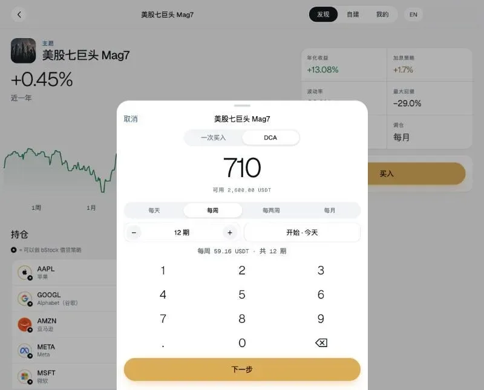

# 用 USDT 定投美股（DCA）：没买的钱也能生息

作者：CRE8 · 2026 年 11 月 23 日 · 阅读约 7 分钟

用 USDT 定投美股，常见做法是在交易所给某只美股代币设定期买入，或者在券商开定投计划。CRE8 的做法是先把整笔 USDT 存进一个组合的账户，按天、周、两周或月分期买，还没轮到买的钱放在 USDT 金库里生息，随时可以领回。想定投一只股票，交易所就够用；想定投一整篮、又不想让等着买的钱闲着，CRE8 的方式更合适。

## 定投（DCA）是什么？

定投就是把一笔钱拆成很多份，按固定周期买入同一个资产，英文叫 DCA（Dollar-Cost Averaging）。比如手上 1,000 U，不一次全买，而是每周买 100 U，买 10 周。

这样做的好处是不用挑买点：价格高的时候同样的钱买得少，价格低的时候买得多。它分散的是「买在哪个价位」的风险，不能保证赚钱，标的一路跌，定投也会亏。

定投有两种安排钱的方式。一种是每期从账户里扣款，没扣的钱放在哪里、有没有利息，你自己安排。另一种是一开始就把整笔钱存进去，系统每期从里面拿一份去买。CRE8 用的是第二种。

## 在币安能定投美股代币吗？

据报道可以。据 [Traders Union](https://tradersunion.com/news/brokers-news/show/2941539-binance-launches-automated-bstock-purchases/) 和 [Blockchain Reporter](https://blockchainreporter.net/binance-stock-recurring-buy-new-stocks-september-17/) 报道，币安的「闪兑」和「买币」可以给 bStock 设定周期买入，每只股票分开设定。我们没有找到币安官方的条款页，频率、最低金额和费用以币安 App 里显示的为准。

bStock 是币安关联公司 BTech Holdings 在 BNB Chain 上发行的美股代币，每枚由托管的正股 1:1 支撑，价格跟着正股走。币安官方写明 bStock 不是股票，分红先扣 30% 美国预扣税，再折成更多代币（[Binance Learn](https://www.binance.com/en/learn/bstocks)）。

在币安定投的好处是直接、熟悉，币安现货 24 小时都能交易。要定投好几只，就得设好几个计划，比例也要自己维持。

## 在券商定投美股是怎么做的？

券商定投买的是真股票，但要先开户、用法币入金。以 moomoo 澳洲为例，定投 10 美元起，只限指定的股票和 ETF（[moomoo AU](https://moomoo.com/au/feature/recurring-investment)）。

对手上只有 USDT 的人，入金是第一道坎。盈透接受稳定币入金，但只收 USDC、PYUSD 和 RLUSD，不收 USDT（[IBKR FAQ](https://www.interactivebrokers.com/support/faq/content/deposit-via-stablecoin-1331500535)）。中国大陆用户从 2026 年 5 月 22 日起在境外券商只能卖出和转出，不能买入和入金，富途、老虎 6 月 12 日起照办（[证监会](https://www.csrc.gov.cn/csrc/c100028/c7634326/content.shtml)、[澎湃新闻](https://www.thepaper.cn/newsDetail_forward_33309776)）。

## CRE8 的定投有什么不一样？

CRE8 的定投是先存一笔，再分期买，没买的部分在 USDT 金库里生息。中文界面也叫「DCA」。

具体是这样：你选一个组合，把整笔 USDT 存进这个组合的账户，设好期数和频率。频率有四种：每天、每周、每两周、每月。每期最少 10 USDT。

每到一期，系统从这笔钱里拿出一份，按组合的权重买齐里面每一只。还没轮到的钱放在 USDT 金库里，按市场利率生息，CRE8 不承诺利率。这部分钱随时可以领回。

和交易所定投比，差别在两点。第一，一期买的是一整篮，不用给每只股票各设一个计划。第二，等着买的钱不是放着不动，而是在金库里生息。

这笔定投的钱只属于这个组合，不算你的现金，也不会和别的组合混在一起。买进来的资产放在你自己的智能账户里（BNB Chain 上只属于你的账户，CRE8 的自动化只能在里面交易，转出必须你本人签名）。

CRE8 目前只在 BNB Chain 测试网，用免费的测试 USDT，不涉及真钱，主网时间还没定。

## 用 1,000 USDT 走一遍

假设你选佩洛西持仓组合，存入 1,000 USDT，分 10 期、每周一期。每期买 100 USDT，按组合权重分配：

| 股票 | 权重 | 每期买入 | 10 期合计 |
|---|---|---|---|
| 英伟达 NVDA | 19% | 19 USDT | 190 USDT |
| 谷歌 GOOGL | 19% | 19 USDT | 190 USDT |
| 微软 MSFT | 19% | 19 USDT | 190 USDT |
| 亚马逊 AMZN | 19% | 19 USDT | 190 USDT |
| 英特尔 INTC | 19% | 19 USDT | 190 USDT |
| 博通 AVGO | 5% | 5 USDT | 50 USDT |

权重以 [佩洛西持仓组合页](https://cre8.finance/zh/portfolios/pelosi) 2026 年 11 月 23 日显示的为准。

再看没买的钱。第 1 期买完，金库里还剩 900 U；第 2 期买完剩 800 U；一直到第 10 期买完归零。10 周里，平均每周有 450 U 在金库里等着。

利息怎么算，用一个假设的利率演示：如果金库年化是 4%，这 10 周大约多出 450 × 4% × 10 ÷ 52 ≈ 3.5 U。这个 4% 只是为了演示算法，不是 CRE8 的利率；实际利率随市场变动，测试网上的利率是模拟的。

中途要用钱，可以把还没买的部分领回来。已经买进的股票留在组合里，想卖可以在美股开盘时卖回 USDT。

还有一个细节：股票代币只在美股交易时段成交。轮到买的那一期如果碰上美股休市，单子会排队到下次开盘再成交。

## 频率和期数怎么定？

先看每期金额能不能到 10 USDT。总额除以期数就是每期金额，1,000 U 最多能拆成 100 期；500 U 最多 50 期。

再看你想把买入拉开多久。同样是 1,000 U、10 期，每天一期是两周买完，每月一期是将近一年买完。拉得越长，买入价格越分散，等着买的钱在金库里放得也越久。

选每天的话要注意休市。美股周末和美国假日不开盘，那几天轮到的单会排队到下次开盘再成交，实际买入会集中在开盘时。

没有哪个频率一定更好。手上的钱多久用不到、能接受多长时间才买完，是比较实际的判断依据。

## 三种定投方式放在一起比

| | 币安定期买入 | 券商定投 | CRE8 DCA（测试网） |
|---|---|---|---|
| 买到的是什么 | bStock（美股代币） | 真股票 | bStock 和加密资产组成的组合 |
| 一个计划买几只 | 一只（据报道逐只设定） | 看券商，常见是一只 | 一整篮，按权重买齐 |
| 能直接用 USDT 吗 | 能 | 多数不能，要先换法币 | 能 |
| 没轮到买的钱 | 留在你的账户，怎么安排你自己决定 | 留在券商账户 | 在 USDT 金库生息，随时领回 |
| 频率 | 以币安 App 为准 | 看券商 | 每天、每周、每两周、每月 |
| 每期最低 | 以币安 App 为准 | moomoo 澳洲 10 美元起 | 10 USDT |
| 资产放哪 | 交易所账户，可提币 | 券商账户 | 你自己的智能账户 |
| 目前状态 | 正式上线（据报道） | 正式上线 | BNB Chain 测试网，不涉及真钱 |

资料查询日：2026-11-23。币安一栏来自二手报导，不是官方条款。

## 什么情况用别的方法就好？

只定投一只股票，比如每周买 50 U 的英伟达，在币安设一个定期买入最省事。

钱本来就在交易所理财里，你也不在乎等着买的钱放在哪，交易所定投就够了。

想要真股票和完整的股东权利，或者想定投 bStock 里没有的股票，用券商定投。前提是你能开户、能用法币入金。

## 定投有哪些风险？

定投不保证赚钱。它只是把买入分散到不同时间，标的长期下跌，定投一样亏。

bStock 不是股票。你持有的是发行方的凭证，权利取决于发行方和托管方。

金库利率会变，可能变低甚至接近零。金库本身也是智能合约，有出错的可能。

组合会涨也会跌。佩洛西持仓组合的模型年化（回测）是 +24.8%，截至 2026 年 11 月 22 日；同一页上近 30 天的模型收益是 −21.2%。模型年化是用现在的权重套历史价格算的，不是实盘战绩。

CRE8 用的是智能合约，合约有出错的可能，上主网前会做第三方审计。

## 常见问题

**CRE8 的定投每期最少多少？**
每期最少 10 USDT。频率可选每天、每周、每两周、每月。

**还没买的钱能拿回来吗？**
能。没轮到买的部分放在 USDT 金库，随时可以领回。

**定投的钱会不会和我的现金混在一起？**
不会。现金、每个组合的资金、加息策略借出的 USDT 互相分开，定投的钱只属于那个组合。

**一次买入和定投哪个好？**
没有固定答案。一次买入马上全仓，定投把买入时间拉开。看你能不能接受一次买在高点，自己判断。

**收费吗？**
测试网全部免费，gas 由 CRE8 付。主网费率会在上线前公布。

## 下一步

想了解等着买的钱和组合里的 bStock 怎么生息，读 [闲置 USDT 怎么生息](/zh/blog/earn-yield-on-usdt-and-bstock)。

---

延伸阅读：[用 USDT 买美股有哪几种方法](/zh/blog/buy-us-stocks-with-usdt)、[使用指南](https://cre8.finance/zh/how-it-works)。

资料来源（查询日期 2026-11-23）：[Traders Union](https://tradersunion.com/news/brokers-news/show/2941539-binance-launches-automated-bstock-purchases/)、[Blockchain Reporter](https://blockchainreporter.net/binance-stock-recurring-buy-new-stocks-september-17/)、[Binance Learn：bStocks](https://www.binance.com/en/learn/bstocks)、[moomoo AU 定投](https://moomoo.com/au/feature/recurring-investment)、[IBKR 稳定币入金](https://www.interactivebrokers.com/support/faq/content/deposit-via-stablecoin-1331500535)、[中国证监会](https://www.csrc.gov.cn/csrc/c100028/c7634326/content.shtml)、[澎湃新闻](https://www.thepaper.cn/newsDetail_forward_33309776)、[CRE8 佩洛西持仓组合页](https://cre8.finance/zh/portfolios/pelosi)、[CRE8 使用指南](https://cre8.finance/zh/how-it-works)。

本文不是投资建议。
