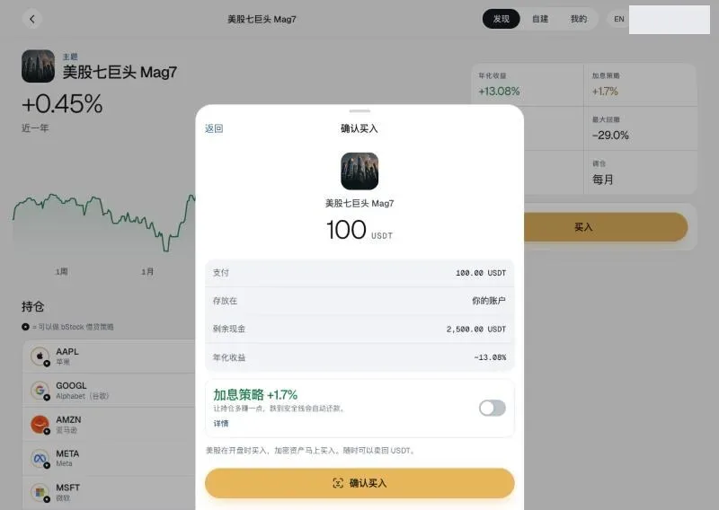

# 闲置 USDT 怎么生息？持有美股的同时让 bStock 多赚一份

作者：CRE8 · 2026 年 11 月 23 日 · 阅读约 8 分钟

闲置的 U 想生息，常见做法有三种：放进交易所理财，存进链上借贷协议的 USDT 金库，或者在 CRE8 账户里点 Earn 存进白名单金库。手上已经有美股代币 bStock 的话，还可以拿它做抵押借一小笔 U 去生息，在币安是当交易保证金，自己上链要自己盯清算，在 CRE8 是一个默认关闭的加息策略开关。收益都跟着市场利率走，没有哪种是保本保息的。

## 先弄懂几个词

bStock 是币安关联公司 BTech Holdings 在 BNB Chain 上发行的美股代币，每枚由托管的正股 1:1 支撑，价格跟着对应股票走。币安官方写明「bStocks 不是股票」（[Binance Learn](https://www.binance.com/en/learn/bstocks)）。

USDT 金库是链上借贷协议里的资金池。你把 U 存进去，借款的人付利息，利息按比例分给存款的人。

抵押借款是把资产押在借贷协议里，借出另一种资产。押的东西价格跌太多，协议会自动卖掉一部分抵押品还债，这叫清算。

智能账户是 BNB Chain 上只属于你的账户。CRE8 的自动化只能在里面帮你交易，钱要转出去，必须你本人签名。

## 闲置的 U 放哪里能生息？

闲置 U 生息的钱，最终都来自借钱的人付的利息，区别在于钱放在谁手上、你要自己操作多少。

### 交易所理财

在币安这类交易所，闲置的 U 可以另外存进理财（Earn）产品。好处是不用碰链上操作，有问题能找客服；钱放在交易所账户里。

如果你平时就把 U 放在交易所、主要在交易所交易，用交易所理财就很省事。

### 自己去链上借贷协议存款

把 U 提到自己的钱包，存进 Venus、Lista 这类 BNB Chain 上的借贷协议。钱一直在你自己的钱包控制下，利率由协议里的借贷供需决定。

要自己做的事：认准官方网址和合约、自己付 gas（链上手续费）、自己判断协议的风险。

### 在 CRE8 账户里点 Earn

CRE8 账户里的 USDT 可以放着不动，也可以点 Earn，存进 CRE8 白名单里的 USDT 金库，目前白名单是 Lista、Venus 和 Aave。每个金库都显示年化，随市场利率浮动，CRE8 不承诺收益率。随存随取，利息一起到账；你不点，CRE8 不会动你的现金（[CRE8 使用指南](https://cre8.finance/zh/how-it-works)）。

它和自己去协议存款用的是同一类金库，差别在于不用自己找协议、认合约，同一个账户里也能买美股组合，不用来回转。

## 手上的 bStock 能不能多赚一份？

能，方法是拿 bStock 做抵押借 U，再把借来的 U 存进金库赚利息。只要金库利息高于借款利息，中间的差就是多赚的部分。代价是多了一层清算风险。

截至 2026 年 11 月 23 日，能这么用 bStock 的地方主要有三类。

### 在币安当保证金

2026 年 9 月 21 日起，币安所有合格用户都能把 bStock 当全仓杠杆和统一保证金账户的抵押品，按折扣计价（[Crypto Briefing](https://cryptobriefing.com/binance-bstocks-margin-collateral/)、[Bitcoin.com](https://news.bitcoin.com/crypto-news/binance-expands-bstocks-collateral-as-tokenized-stock-volumes-jump-33x/)）。

这个功能是给交易用的：bStock 让你有更多保证金去开杠杆仓位，它本身不产生利息。要做杠杆交易的人，用币安这个功能就够了。

### 提到钱包，自己去 Venus 或 Lista 抵押

bStock 可以提到 BNB Chain 钱包，再自己去借贷协议使用（[BNB Chain 官方博客](https://bnbchain.org/en/blog/introducing-bstocks-on-bnb-chain-trade-24-7-with-zero-fees-deploy-across-defi-protocols-with-full-self-custody)）。目前查得到的有两家：

| 协议 | 接受的 bStock | 上线时间 | 来源 |
|---|---|---|---|
| Venus（Core Pool） | TSLAB、NVDAB、SPCXB，抵押率分别为 60%、60%、50% | 2026 年 6 月 20 日 | [CryptoSlate](https://cryptoslate.com/tokenized-stocks-defi-collateral-venus/) |
| Lista DAO | NVDAB、TSLAB、MUB | 约 2026 年 6 月 16 日 | [Crypto Briefing](https://cryptobriefing.com/bstocks-lista-dao-defi-integration/) |

抵押率是协议规定的「最多能借抵押品价值的几成」。抵押率 60% 的意思是，押 1,000 U 的股票，最多借 600 U。

自己做的好处是每一步都自己定：借多少、存哪个金库、什么时候还。代价也是每一步都要自己做：存抵押、借款、存金库，股价跌的时候自己补抵押或还款，晚了就会被清算。

### 在 CRE8 开加息策略

买组合时可以顺手打开加息策略。它默认关闭，要你自己开。打开后，CRE8 把组合里的股票存进借贷市场做抵押，只借市场允许额度的一小部分 USDT，再存进 USDT 金库。

价格跌到安全线时，系统会自动用金库里的 USDT 还掉一部分借款，股票不会被卖，事后在活动记录里告诉你还了多少。随时可以关，股票会留在组合里。杠杆组合（3 倍半导体、3 倍纳指）不提供加息策略（[CRE8 使用指南](https://cre8.finance/zh/how-it-works)）。

它和自己去 Venus、Lista 做的是同一件事，区别是借多少、什么时候还由系统按保守规则处理，你不用盯盘。代价是参数不能自己调，想借得更多的人不适合。

## 三种钱为什么要分开？

在 CRE8，你的现金、每个组合的资金、加息策略借来的 U，永远分开记账。

加息策略借来的 USDT 只属于那个组合：它不算你的现金，你点提现时不会提到它；它也不会和别的组合混在一起，一个组合跌到安全线要还款，动用的只是这个组合自己金库里的 U。这样一个组合出状况，不会拖累你的现金和其他组合。

## 放在一起比

截至 2026 年 11 月 23 日：

| | 交易所理财 | 币安 bStock 保证金 | 自己去 Venus／Lista | CRE8（测试网） |
|---|---|---|---|---|
| 闲置 U 能生息吗 | 能 | 不适用 | 能，自己存进协议 | 能，点 Earn 存进白名单金库 |
| bStock 能多赚吗 | 没查到官方说明 | 不产生利息，用来开杠杆 | 能，自己抵押借款再存款 | 能，开加息策略 |
| 钱放在哪 | 交易所账户 | 交易所账户 | 你自己的钱包 | 你自己的智能账户 |
| 借多少谁决定 | 不适用 | 你自己 | 你自己，最多到协议抵押率 | 系统，只借允许额度的一小部分 |
| 股价下跌时 | 不适用 | 保证金不足会被强平 | 自己补仓或还款，晚了被清算 | 跌到安全线自动用金库 U 还款，不卖股票 |
| 要懂 DeFi 吗 | 不用 | 要懂杠杆 | 要 | 不用 |
| 能自己调参数吗 | 不适用 | 能 | 能 | 不能，只能开或关 |
| 目前状态 | 正式运行 | 正式运行 | 正式运行 | BNB Chain 测试网，金库和利率是模拟的 |

## 用 1,000 U 走一遍是什么样？

假设你在 CRE8 测试网账户里有 1,000 测试 USDT，打算 700 U 买美股七巨头组合，剩下 300 U 先放着。

第一步，买组合。美股七巨头组合是苹果、微软、谷歌、亚马逊、英伟达、Meta、特斯拉七只，各占约 14.29%。700 U 一笔付款，系统按权重每只买入约 100 U（[组合页](https://cre8.finance/zh/portfolios/mag7)）。

第二步，打开加息策略。买入时打开开关，系统把这七只 bStock 存进借贷市场做抵押，借出的 U 只是市场允许额度的一小部分，存进这个组合专属的 USDT 金库。

第三步，闲置的 300 U 点 Earn。选一个白名单金库存进去，页面会显示当前年化。这 300 U 和组合借来的 U 分开记，哪天想买别的组合，从 Earn 领回来就能用。

如果股价大跌，组合碰到安全线，系统自动从这个组合的金库里拿 U 还掉一部分借款。七只股票的数量不变，你的 300 U 现金也不受影响。

测试网上的金库和利率都是模拟的，上面的流程是真的，数字只能当示意。

## 自己抵押时，跌多少会被清算？

用 Venus 的抵押率粗算一次。押 1,000 U 的 NVDAB，抵押率 60%，最多能借 600 U。

如果你借了 500 U，股票价值跌到约 833 U 时（跌约 17%），可借上限就只剩 500 U，借款和上限一样，再跌就会被清算。如果只借 200 U，股票要跌到约 333 U（跌约 67%）才到这条线。

借得越少，离清算越远，但赚的利差也越少。实际的清算线以协议页面为准，各协议会调整参数。CRE8 只借允许额度的一小部分，也是这个道理。

## 什么情况用别的方法就好？

只想让闲置的 U 生息，钱也习惯放交易所，用交易所理财就好，不用学链上操作。

要做杠杆交易，用币安把 bStock 当保证金，CRE8 不做杠杆和合约。

懂 DeFi、想自己决定借多少、存哪里，或者想借得比保守比例更多，自己去 Venus、Lista 操作更灵活。

买的是杠杆组合，CRE8 不提供加息策略。

## 有哪些风险？

清算风险。抵押借款的股票跌太多就会被清算。CRE8 只借市场允许额度的一小部分，跌到安全线先用金库的 U 还款，这样风险很低，但不是零。自己去协议操作，清算线完全要自己盯。

利率会变。金库的收益来自借款人付的利息，借的人少了，年化就会降，可能接近零。加息策略还多一层：借款利率可能高过金库利率，这段时间组合反而要倒贴利息。CRE8 不承诺任何收益率。

合约风险。Lista、Venus、Aave 和 CRE8 本身都是智能合约，合约可能出错或被攻击。CRE8 只用白名单金库，上主网前会做第三方审计，目前还没完成。

bStock 不是股票。你持有的是发行方的凭证，权利取决于发行方和托管方；分红先扣 30% 美国预扣税再折成代币。

价格会跌。生息赚的是利息，股票本身的涨跌和加息策略无关，组合照样可能亏钱。

CRE8 目前只在 BNB Chain 测试网，用的是免费的测试 USDT，不涉及真钱，主网上线时间还没定。

## 常见问题

**加息策略要不要另外付钱？**
测试网全部免费，gas 由 CRE8 付。主网费率会在上线前公布。

**开了加息策略，股票会被卖掉吗？**
不会。股票存进借贷市场做抵押，跌到安全线时系统用金库里的 U 还款，不卖股票。随时可以关掉，股票会留在组合里。

**Earn 里的 U 能随时取吗？**
能。随存随取，利息一起到账，你不点，CRE8 不会动你的现金。

**测试网上看到的年化是真的吗？**
不是。测试网上的金库和利率都是模拟的，只能当示意。主网上线后，年化跟着各金库的市场利率走。

**CRE8 和 Solana 上的 CRE8 Finance 是同一个吗？**
不是。CRE8 在 BNB Chain 上，目前没有发行代币。

## 下一步

Earn 和加息策略的完整规则，可以看 [CRE8 使用指南](https://cre8.finance/zh/how-it-works)。还没决定买什么，可以先看 [用 USDT 买美股有哪几种方法](/zh/blog/buy-us-stocks-with-usdt) 和 [币安和 CRE8 的差别](/zh/blog/binance-bstock-vs-cre8)。

---

资料来源（查询日期 2026-11-23）：[CRE8 使用指南](https://cre8.finance/zh/how-it-works)、[Binance Learn：bStocks](https://www.binance.com/en/learn/bstocks)、[Crypto Briefing（币安保证金）](https://cryptobriefing.com/binance-bstocks-margin-collateral/)、[Bitcoin.com](https://news.bitcoin.com/crypto-news/binance-expands-bstocks-collateral-as-tokenized-stock-volumes-jump-33x/)、[BNB Chain 官方博客](https://bnbchain.org/en/blog/introducing-bstocks-on-bnb-chain-trade-24-7-with-zero-fees-deploy-across-defi-protocols-with-full-self-custody)、[CryptoSlate（Venus）](https://cryptoslate.com/tokenized-stocks-defi-collateral-venus/)、[Crypto Briefing（Lista）](https://cryptobriefing.com/bstocks-lista-dao-defi-integration/)。

本文只是说明各种生息做法的差别，不是投资建议。
