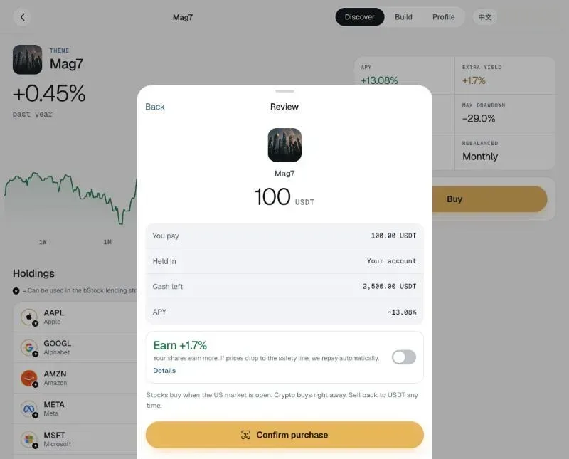

# How to Earn Yield on Idle USDT While Holding US Stock Tokens

By CRE8 · November 23, 2026 · 8 min read

You can earn yield on idle USDT in three common ways: an exchange's Earn product, a USDT vault in an on-chain lending protocol, or the Earn button in a CRE8 account, which deposits into allowlisted vaults. If you also hold bStock, Binance's tokenized US stocks, you can borrow a small amount of USDT against them and put that to work too: on Binance the stock tokens serve as trading margin, on your own you manage the liquidation risk, and on CRE8 it's a yield strategy that stays off until you switch it on. Every one of these pays market rates, and none of them guarantees a return.

## What do these terms mean?

bStock is a tokenized US stock on BNB Chain, issued by BTech Holdings, a Binance affiliate. Each token is backed 1:1 by a share held with a custodian and tracks that stock's price. Binance states that "bStocks are not shares" ([Binance Learn](https://www.binance.com/en/learn/bstocks)).

A USDT vault is a pool in an on-chain lending protocol. You deposit USDT, borrowers pay interest, and depositors share that interest.

A collateralized loan means locking up one asset in a lending protocol to borrow another. If the collateral falls too far in value, the protocol automatically sells part of it to repay the debt. That forced sale is called liquidation.

A smart account is an on-chain account on BNB Chain that belongs to you. CRE8's automation can trade inside it, but moving funds out takes your signature.

## Where can idle USDT earn yield?

The yield on USDT always comes from interest paid by borrowers. What changes from one option to the next is who holds your money and how much you have to do yourself.

### An exchange Earn product

On an exchange like Binance, idle USDT can go into a separate Earn product. You never touch a wallet or a blockchain transaction, and support is a ticket away. Your money stays in your exchange account.

If you already keep your USDT on an exchange and do most of your trading there, this is the simplest choice.

### Depositing in a lending protocol yourself

You withdraw USDT to your own wallet and deposit it in a lending protocol on BNB Chain, such as Venus or Lista. The funds stay under your wallet's control, and the rate moves with supply and demand inside the protocol.

The work is yours: finding the official site and contract, paying gas (the network's transaction fee), and judging each protocol's risk.

### Earn in a CRE8 account

USDT in a CRE8 account can sit there, or you can press Earn to deposit it in one of CRE8's allowlisted USDT vaults. The allowlist today is Lista, Venus and Aave. Each vault shows its APY (annual percentage yield, the yearly return including compounding), which follows market rates; CRE8 doesn't promise a rate. You can withdraw any amount, interest included, at any time, and CRE8 never moves your cash unless you ask it to ([How CRE8 works](https://cre8.finance/how-it-works)).

These are the same kind of vaults you'd use on your own. The difference is that you don't have to hunt down protocols or verify contracts, and the same account also holds your stock portfolios, so there's no shuffling funds between wallets.

## Can your bStock earn something extra?

Yes. You post bStock as collateral, borrow USDT, and deposit that USDT in a vault. As long as the vault pays more than the loan costs, you keep the difference. The trade-off is that you now carry liquidation risk.

As of November 23, 2026, there are three main ways to do this.

### As margin on Binance

Since September 21, 2026, all eligible Binance users can post bStock as collateral in Cross Margin and Portfolio Margin accounts, valued at a discount ([Crypto Briefing](https://cryptobriefing.com/binance-bstocks-margin-collateral/), [Bitcoin.com](https://news.bitcoin.com/crypto-news/binance-expands-bstocks-collateral-as-tokenized-stock-volumes-jump-33x/)).

This feature is built for trading. Your bStock gives you more margin to open leveraged positions; it doesn't pay interest on its own. If leveraged trading is what you want, Binance already covers it.

### On Venus or Lista, on your own

You can withdraw bStock to a BNB Chain wallet and use it in DeFi protocols yourself ([BNB Chain blog](https://bnbchain.org/en/blog/introducing-bstocks-on-bnb-chain-trade-24-7-with-zero-fees-deploy-across-defi-protocols-with-full-self-custody)). Two protocols are on record:

| Protocol | bStock accepted | Since | Source |
|---|---|---|---|
| Venus (Core Pool) | TSLAB, NVDAB, SPCXB, with collateral factors of 60%, 60% and 50% | June 20, 2026 | [CryptoSlate](https://cryptoslate.com/tokenized-stocks-defi-collateral-venus/) |
| Lista DAO | NVDAB, TSLAB, MUB | Around June 16, 2026 | [Crypto Briefing](https://cryptobriefing.com/bstocks-lista-dao-defi-integration/) |

The collateral factor is the share of your collateral's value the protocol lets you borrow. At 60%, 1,000 USDT worth of stock tokens lets you borrow up to 600 USDT.

Doing it yourself means you set every parameter: how much to borrow, which vault to use, when to repay. It also means you run every step: deposit the collateral, borrow, deposit the USDT, and when the stock drops, add collateral or repay before you get liquidated.

### With CRE8's yield strategy

When you buy a portfolio on CRE8, you can switch on the yield strategy. It's off by default. Once it's on, CRE8 deposits the portfolio's shares in a lending market, borrows a small, conservative amount of USDT against them (only a small part of what the market would allow), and puts that USDT in a vault.

If prices fall to the safety line, the system automatically repays part of the loan from the vault, without selling your shares, and your activity log tells you afterwards how much was repaid. You can switch it off at any time and the shares stay in the portfolio. Leveraged portfolios (3x Semiconductors, 3x Nasdaq) don't offer it ([How CRE8 works](https://cre8.finance/how-it-works)).

It's the same mechanism as doing it on Venus or Lista yourself. The difference is that the borrowing amount and the repayments follow conservative rules, so you don't have to watch the market. The flip side: you can't tune the parameters, so it won't suit anyone who wants to borrow more.

## Why does CRE8 keep the money separate?

CRE8 tracks three pots of money separately: your cash, each portfolio's funds, and the USDT a yield strategy borrows.

USDT borrowed by a portfolio's yield strategy belongs to that portfolio only. It never counts as your cash, so it isn't part of what you can withdraw, and it never mixes with another portfolio. If one portfolio hits its safety line, the repayment comes only from that portfolio's own vault. One portfolio's trouble doesn't spill into your cash or your other portfolios.

## How do the options compare?

As of November 23, 2026:

| | Exchange Earn | bStock as Binance margin | Venus / Lista yourself | CRE8 (testnet) |
|---|---|---|---|---|
| Idle USDT earns yield | Yes | Not applicable | Yes, you deposit it | Yes, press Earn |
| bStock earns extra | No official info found | No interest; used for leverage | Yes, you borrow and deposit | Yes, with the yield strategy |
| Where your money sits | Exchange account | Exchange account | Your own wallet | Your own smart account |
| Who decides how much to borrow | Not applicable | You | You, up to the collateral factor | The system, a small part of the limit |
| When the stock falls | Not applicable | Liquidated if margin runs short | Top up or repay yourself, or get liquidated | Auto-repays from the vault at the safety line, no share sales |
| DeFi knowledge needed | No | Need to understand leverage | Yes | No |
| Adjustable settings | Not applicable | Yes | Yes | No, on or off only |
| Status | Live | Live | Live | BNB Chain testnet; vaults and rates are simulated |

## What does it look like with 1,000 USDT?

Say your CRE8 testnet account holds 1,000 test USDT. You want 700 USDT in the Mag7 portfolio and keep 300 USDT on the side.

Step one: buy the portfolio. Mag7 holds Apple, Microsoft, Alphabet, Amazon, Nvidia, Meta and Tesla at about 14.29% each. One 700 USDT payment buys roughly 100 USDT of each ([Mag7 portfolio](https://cre8.finance/portfolios/mag7)).

Step two: switch on the yield strategy at checkout. CRE8 deposits the seven bStock tokens in a lending market as collateral, borrows a small part of what the market allows, and puts that USDT in a vault that belongs to this portfolio alone.

Step three: press Earn on the 300 USDT. Pick an allowlisted vault; the page shows its current APY. This 300 USDT is tracked apart from the portfolio's borrowed USDT. When you want to buy another portfolio, withdraw it from Earn and it's ready.

If stocks drop sharply and the portfolio hits its safety line, the system repays part of the loan from that portfolio's vault. You still hold the same number of shares in all seven stocks, and your 300 USDT of cash isn't touched.

On testnet the vaults and rates are simulated. The flow above is real; treat any numbers you see as illustrations.

## How far can a stock fall before liquidation?

Here's a rough calculation using Venus's collateral factor. You post 1,000 USDT worth of NVDAB. At 60%, you can borrow up to 600 USDT.

Borrow 500 USDT, and once the collateral falls to about 833 USDT (a drop of about 17%), your limit shrinks to 500 USDT, equal to your debt. Any further drop puts you at risk of liquidation. Borrow only 200 USDT, and the collateral has to fall to about 333 USDT (a drop of about 67%) before you reach that point.

The less you borrow, the further you are from liquidation, and the less you earn. Each protocol publishes its actual liquidation thresholds and can change them. CRE8 borrows only a small part of the limit for exactly this reason.

## When is another option a better fit?

If you just want idle USDT to earn and you keep your money on an exchange anyway, an exchange Earn product does the job without any on-chain steps.

If you want leveraged trading, use bStock as margin on Binance. CRE8 doesn't offer leverage or derivatives.

If you know DeFi and want to choose how much to borrow and where to deposit, or want to borrow more than a conservative amount, Venus or Lista gives you full control.

If you hold a leveraged portfolio, CRE8's yield strategy isn't available for it.

## What are the risks?

Liquidation. If borrowed-against stock falls far enough, it gets liquidated. CRE8 borrows only a small part of what the market allows and repays from the vault at the safety line, which keeps the risk low but doesn't remove it. If you borrow on your own, watching the liquidation line is entirely on you.

Changing rates. Vault yield comes from borrowers' interest. When borrowing demand falls, so does the APY, and it can approach zero. The yield strategy adds one more layer: if the loan rate rises above the vault rate, the portfolio pays more in interest than it earns for as long as that lasts. CRE8 doesn't promise any rate.

Smart contract risk. Lista, Venus, Aave and CRE8 all run on smart contracts, which can have bugs or be exploited. CRE8 uses only allowlisted vaults, and its contracts get an external audit before mainnet. That audit hasn't happened yet.

bStock isn't a share. You hold a claim through the issuer, and your rights depend on the issuer and custodian. Dividends arrive as extra tokens after a 30% US withholding tax.

Prices can fall. Yield is interest on top; the stocks themselves still move up and down, and a portfolio can lose money whether or not the yield strategy is on.

CRE8 is on BNB Chain testnet only. It uses free test USDT, no real money is involved, and there's no mainnet date yet.

## FAQ

**Does the yield strategy cost extra?**
On testnet everything is free and CRE8 pays the gas. Mainnet fees will be announced before launch.

**Will the yield strategy sell my shares?**
No. The shares are posted as collateral, and at the safety line the system repays from the vault instead of selling them. You can switch it off any time and the shares stay in the portfolio.

**Can I withdraw USDT from Earn at any time?**
Yes. Withdraw any amount, interest included, whenever you like. CRE8 never moves your cash unless you ask it to.

**Are the APYs I see on testnet real?**
No. Testnet vaults and rates are simulated. On mainnet, the APY will follow each vault's market rate.

**Is CRE8 related to CRE8 Finance on Solana?**
No. CRE8 runs on BNB Chain and has no token at present.

## Next step

For the full rules on Earn and the yield strategy, read [How CRE8 works](https://cre8.finance/how-it-works). If you're still deciding what to buy, start with [the ways to buy US stocks with USDT](/blog/buy-us-stocks-with-usdt) and [Binance bStock vs CRE8](/blog/binance-bstock-vs-cre8).

---

Sources (accessed November 23, 2026): [How CRE8 works](https://cre8.finance/how-it-works), [Binance Learn: bStocks](https://www.binance.com/en/learn/bstocks), [Crypto Briefing (Binance margin)](https://cryptobriefing.com/binance-bstocks-margin-collateral/), [Bitcoin.com](https://news.bitcoin.com/crypto-news/binance-expands-bstocks-collateral-as-tokenized-stock-volumes-jump-33x/), [BNB Chain blog](https://bnbchain.org/en/blog/introducing-bstocks-on-bnb-chain-trade-24-7-with-zero-fees-deploy-across-defi-protocols-with-full-self-custody), [CryptoSlate (Venus)](https://cryptoslate.com/tokenized-stocks-defi-collateral-venus/), [Crypto Briefing (Lista)](https://cryptobriefing.com/bstocks-lista-dao-defi-integration/).

This article explains how these yield options differ. It is not investment advice.
