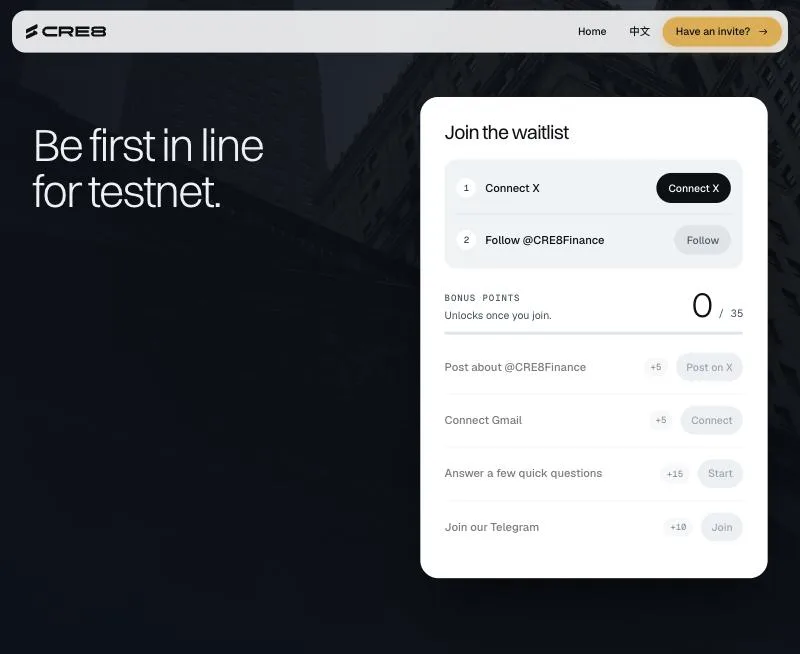
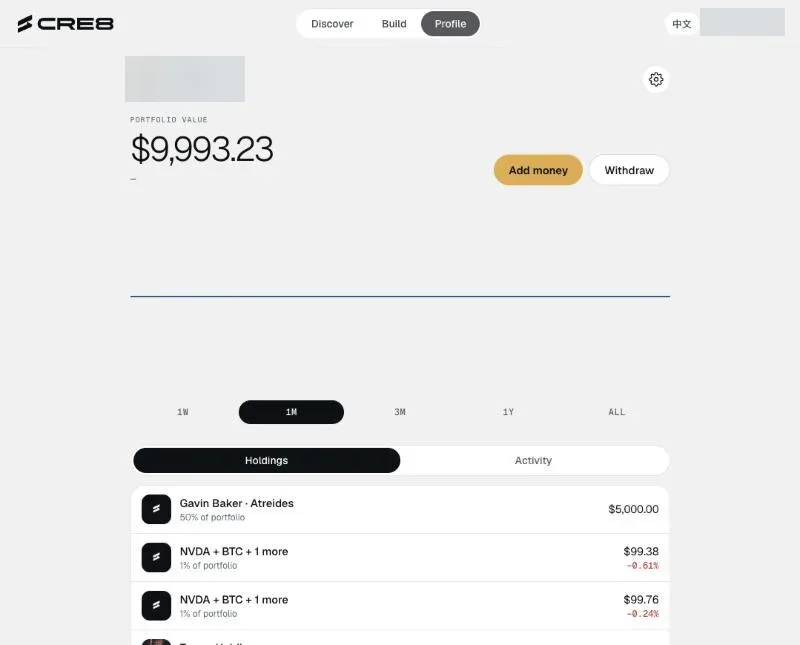
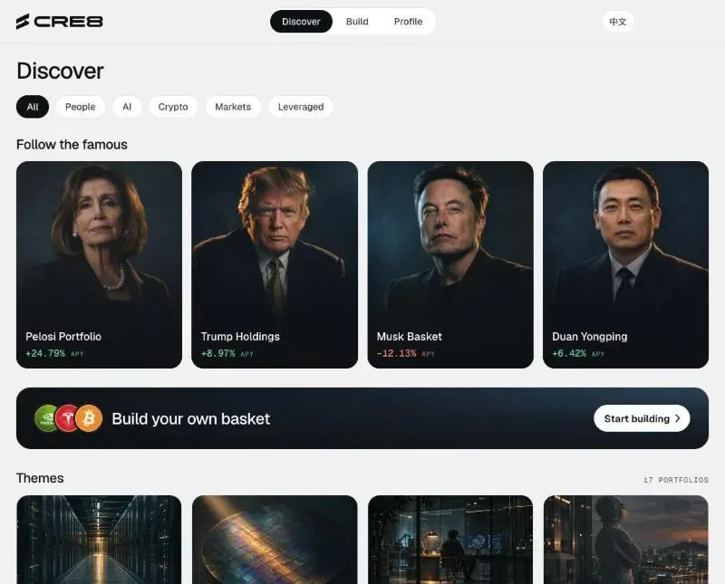
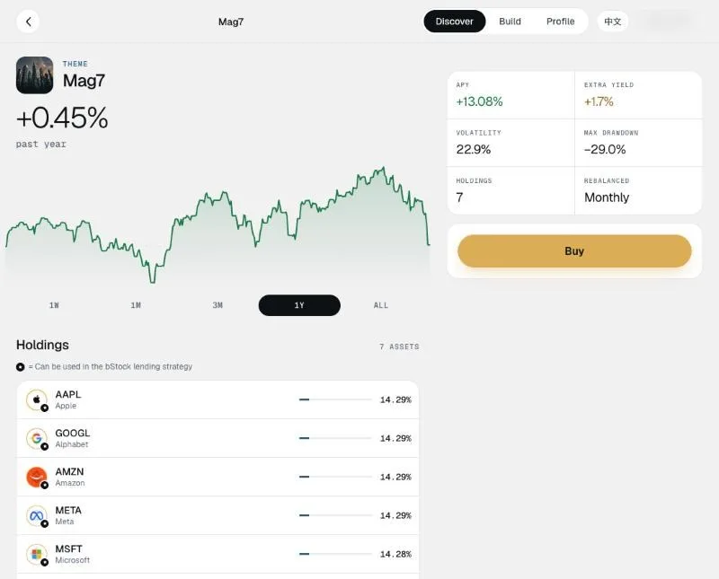
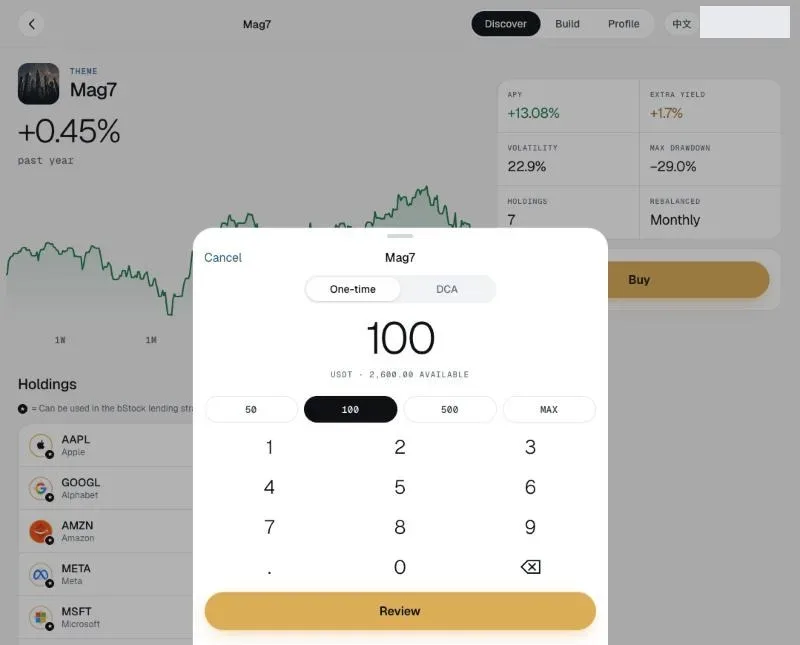
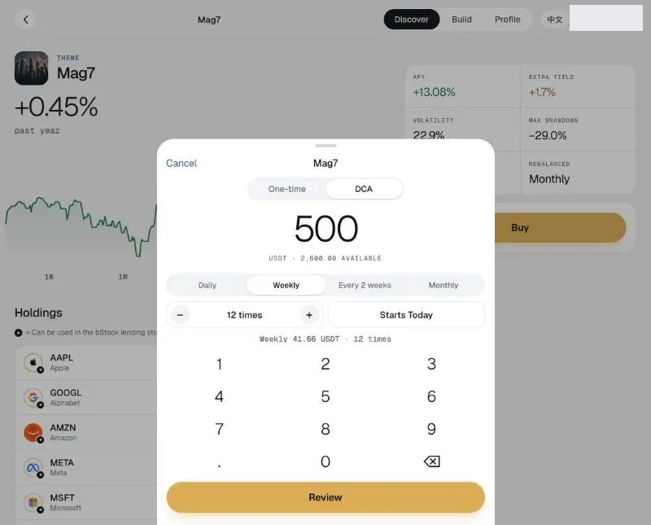
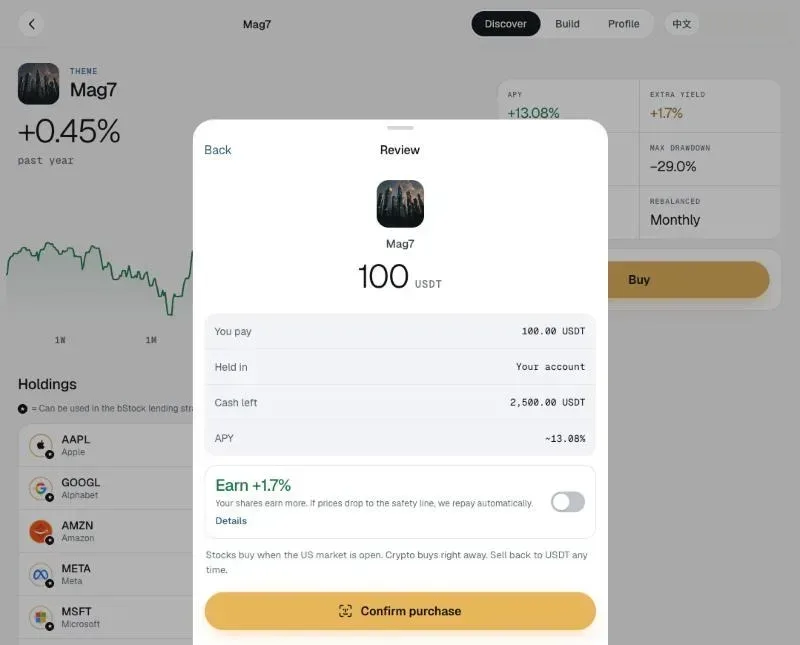
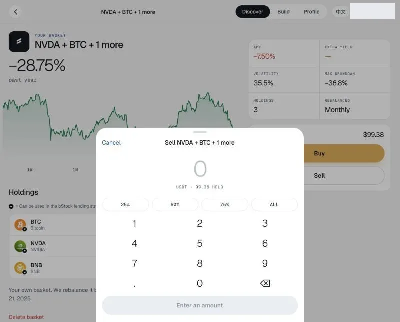

# How to Buy Your First Portfolio on CRE8, Step by Step

By CRE8 · November 23, 2026 · 7 min read

Buying your first portfolio on CRE8 takes six steps: join the waitlist for an invite code, sign in with the code and your X account, claim free test USDT, pick a portfolio, enter an amount (50 USDT minimum) and confirm, then sell back to USDT and withdraw whenever you want. You pay in USDT and never swap stocks one by one on a DEX. CRE8 currently runs only on BNB Chain testnet, with test USDT, so no real money is involved.

## What do you need to know before you start?

CRE8 (cre8.finance) is an app on BNB Chain for buying baskets of tokenized US stocks and crypto with USDT, held in your own smart account, with yield strategies that put your bStock to work.

A **smart account** is an on-chain account CRE8 opens for you on BNB Chain, owned by the wallet you sign in with. Your assets sit there, never pooled with anyone else's, and moving anything out takes your signature ([How CRE8 works](https://cre8.finance/how-it-works)).

bStock is a tokenized US stock on BNB Chain issued by BTech Holdings, a Binance affiliate, and each token is backed 1:1 by shares held with a custodian. Binance states that "bStocks are not shares," and dividends arrive as extra tokens after a 30% US withholding tax ([Binance Learn](https://www.binance.com/en/learn/bstocks)).

A portfolio is a basket of assets at fixed target weights, like the Magnificent Seven at about 14.3% each. Gas is the network fee every on-chain transaction pays; on testnet, CRE8 covers it.

## Step 1: How do you get a testnet invite code?

The testnet is invite-only, so start at [cre8.finance/waitlist](https://cre8.finance/waitlist). The page asks you to connect your X account and follow @CRE8Finance. There are also optional bonus tasks, such as posting about @CRE8Finance, answering a few quick questions and joining the Telegram group.

If you already have a code, the waitlist page has a "Have an invite?" link that takes you to the testnet. The testnet app lives at [tst.cre8.finance](https://tst.cre8.finance) and nowhere else. Don't sign in on any other domain.

## Step 2: How do you sign in?

The first time, enter your invite code and connect your X account; after that you can also sign in with X, Google or email. CRE8 then opens a smart account for you on BNB Chain that only you control ([How CRE8 works](https://cre8.finance/how-it-works)). Signing in to the testnet needs an invite code.

You don't need to sign in just to look around. Every portfolio's holdings, weights and history are public on the [portfolios page](https://cre8.finance/portfolios).

## Step 3: Where does the USDT come from?

On testnet, you claim free test USDT inside the app. Test USDT only works on testnet. It has no real value and can't be turned into real money.

Once claimed, it sits in your own smart account. You can leave it there, or tap Earn to put it in one of CRE8's allowlisted USDT vaults (Lista, Venus, Aave) and take it out whenever you like. CRE8 never moves your cash unless you ask. Testnet vaults and rates are simulated. More on this in [how to earn yield on idle USDT](/blog/earn-yield-on-usdt-and-bstock).

## Step 4: Which portfolio should you pick?

CRE8 has 21 curated portfolios in three groups: people (Pelosi, Trump, Duan Yongping, Musk), 15 themes, and 2 leveraged ones (3x Semiconductors, 3x Nasdaq). Every portfolio page shows its holdings, weights and model APY.

Model APY is a backtest: current weights applied to historical prices. It is not a track record. As of November 22, 2026, [Mag7](https://cre8.finance/portfolios/mag7) shows a model APY of +13.1% and [AI Chips](https://cre8.finance/portfolios/ai-chips) shows +61.4% ([CRE8 llms.txt](https://cre8.finance/llms.txt), checked November 23, 2026). Higher numbers usually come with bigger drops.

For a first run, pick a portfolio whose names you recognize, like Mag7, and learn the flow. If you'd rather choose your own stocks and weights, CRE8 rebalances those too; see [build your own portfolio](/blog/build-your-own-portfolio).

## Step 5: How much do you enter, and do you buy now or DCA?

On the portfolio page, enter an amount and confirm. The minimum is 50 USDT per purchase. One confirmation buys every asset in the basket at its target weight, so you don't place an order per stock.

You have two ways to buy.

Buy once: the full amount goes into the portfolio right away, at target weights.

DCA (dollar-cost averaging, buying a fixed amount on a schedule): you deposit a lump sum into that portfolio's account, and CRE8 buys one slice each period. Choose daily, weekly, every two weeks or monthly, with at least 10 USDT per slice. The part not yet invested earns yield while it waits. Details in [how to DCA into US stocks with USDT](/blog/dca-us-stocks-with-usdt).

Before you confirm, you can also choose whether to turn on the yield strategy. It's off by default. When on, CRE8 deposits the portfolio's shares in a lending market, borrows a small, conservative amount of USDT against them and puts that in a USDT vault. If prices fall to the safety line, the system repays part of the loan from the vault automatically, without selling your shares. You can switch it off anytime. The risk is low but not zero, and leveraged portfolios don't offer it ([How CRE8 works](https://cre8.finance/how-it-works)).

For your first purchase, it's fine to leave it off until you know the app.

## Step 6: What happens after you confirm?

Trades go only through allowlisted on-chain venues: PancakeSwap, KyberSwap and OpenOcean. Each asset has a per-trade cap, so large orders are split into several trades ([How CRE8 works](https://cre8.finance/how-it-works)).

If the US market is closed, stock tokens don't trade. Your order waits in your account and goes through at the next open, and your USDT stays in your own account until then.

After you buy, the portfolio keeps its shape. Curated portfolios rebalance once a month, and whenever an asset drifts more than 5 percentage points from its target weight. For a worked rebalancing example, see [how to buy a basket of US stocks with USDT](/blog/buy-us-stock-basket-with-usdt).

## What does it look like with 100 USDT?

Say you've claimed test USDT and want to put 100 USDT into Mag7.

Mag7's weights are Apple, Alphabet, Amazon and Meta at 14.29% each, and Microsoft, NVIDIA and Tesla at 14.28% each ([CRE8 llms.txt](https://cre8.finance/llms.txt)). Enter 100 and confirm once. Apple, Alphabet, Amazon and Meta get 14.29 USDT each; Microsoft, NVIDIA and Tesla get 14.28 USDT each, for 100 USDT total. The number of bStock tokens you receive depends on the fill price, and pool fees and slippage move it slightly.

Place that order on a Saturday and the market is closed, so the 100 USDT stays in your account until US trading opens on Monday.

Doing the same on an exchange means seven orders, each sized by hand; Binance's minimum per bStock is about $5 ([Binance Learn](https://www.binance.com/en/learn/bstocks)). When the weights drift, the math and the trades are on you.

With DCA instead, you might deposit 500 USDT and buy 50 USDT a week for 10 weeks. Week one buys 50 USDT of Mag7, the other 450 USDT earns while it waits, and week two buys the next 50.

Testnet prices are simulated, so these numbers only illustrate the flow.

## How do you sell and withdraw later?

Sell some or all of a portfolio back to USDT, and the money lands in your account. From there, withdraw USDT to any BNB Chain address, including an exchange deposit address ([How CRE8 works](https://cre8.finance/how-it-works)).

Large sales go through in a few trades because of the per-asset cap. Selling stock tokens while the market is closed also waits for the next open.

Withdrawals need your signature. CRE8's automation can only trade inside your account; it can't move anything out. On testnet, the USDT has no real value and an exchange won't credit it, so this step only matters once mainnet launches.

## How does a first purchase compare with other ways to buy?

| | Buy bStock one by one on an exchange | Buy tokens yourself on-chain | CRE8 (testnet) |
|---|---|---|---|
| What you need | An exchange account | Your own wallet, seed phrase, BNB for gas | Invite code and an X account |
| Orders for a basket | One per stock | One swap per stock | One USDT payment |
| Who sets the weights | You | You | Published on the portfolio page, or you build your own |
| Where assets sit | Exchange account | Your wallet | Your own smart account |
| Minimum | About $5 per stock | Depends on gas | 50 USDT per purchase; 10 USDT per DCA slice |
| When trades fill | 24/7 | Depends on pool liquidity | Stock tokens only during US market hours |
| When weights drift | You rebalance | You rebalance | Automatic rebalancing |
| Status | Live | Live | BNB Chain testnet, no real money |

Data checked November 23, 2026. Binance figures from [Binance Learn](https://www.binance.com/en/learn/bstocks).

## When is another option a better fit?

If you only want one or two stocks, buying on Binance directly is faster, from about $5 per stock, and you don't need a basket.

If you want fills at any hour, Binance spot trades 24/7, while CRE8 trades stock tokens only during US market hours.

If you want to invest real money today, CRE8 isn't on mainnet yet, and there's no mainnet date.

If you're in the US, CRE8 isn't available to you. It's open to users outside the US where local rules allow.

## What are the risks?

Prices can fall. A basket spreads single-stock risk, not market risk; when US stocks drop together, the portfolio drops too.

Model APY is not a promise. It's a backtest, and a different time window can give a very different number. Testnet balances also move on simulated prices.

bStock is not a share. You hold the issuer's token, and your rights differ from owning shares at a broker ([Binance Learn](https://www.binance.com/en/learn/bstocks)).

The yield strategy's risk is low but not zero, and testnet vaults and rates are simulated.

Smart contract risk applies. CRE8 runs on smart contracts that get a third-party audit before mainnet; that audit isn't done yet.

## FAQ

### Can I use CRE8 without an invite code?

You can't sign in to the testnet app, but you can browse every portfolio's holdings and history on the website. Join the [waitlist](https://cre8.finance/waitlist) and wait for an invite.

### Do I need a wallet first?

The first sign-in takes an invite code and an X account; after that Google or email works too, and CRE8 opens a smart account for you on BNB Chain.

### Does the testnet cost anything?

No. It's free, and CRE8 pays the gas. Mainnet fees will be announced before launch.

### Can I switch to a different portfolio later?

Yes. Sell some or all of the current one back to USDT, then use that USDT to buy another. Each portfolio's money is kept separate.

### Does CRE8 have a token?

No. CRE8 hasn't issued a token and has no connection to CRE8 Finance on Solana or any CRE8 token.

## Next step

Join the [waitlist](https://cre8.finance/waitlist). Once you have an invite code, you can run through the whole flow with test USDT.

---

Sources (checked November 23, 2026): [How CRE8 works](https://cre8.finance/how-it-works), [CRE8 waitlist](https://cre8.finance/waitlist), [CRE8 llms.txt](https://cre8.finance/llms.txt), [CRE8 Mag7 portfolio](https://cre8.finance/portfolios/mag7), [CRE8 AI Chips portfolio](https://cre8.finance/portfolios/ai-chips), [Binance Learn: bStocks](https://www.binance.com/en/learn/bstocks).

This article explains how to use the CRE8 testnet. It is not investment advice.
