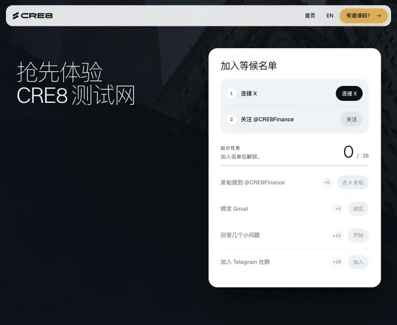
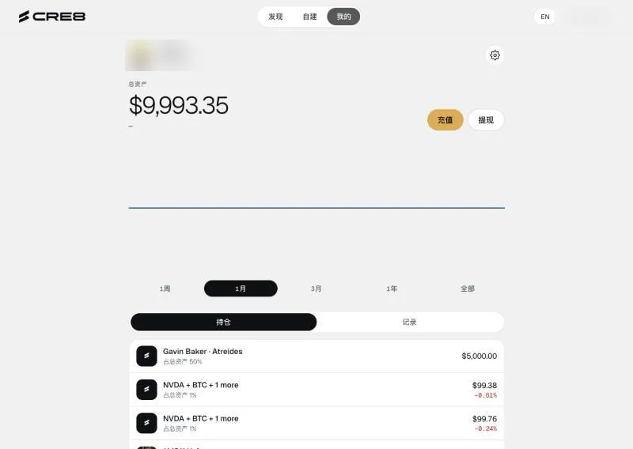
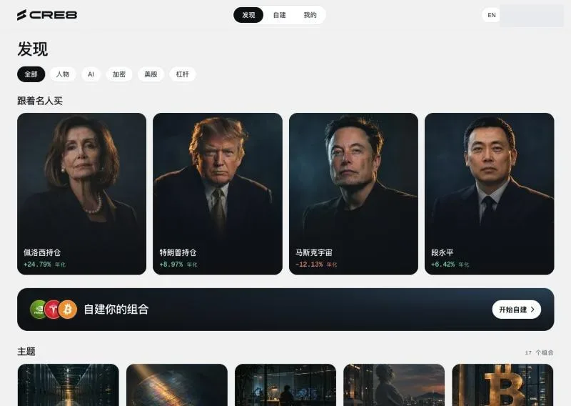
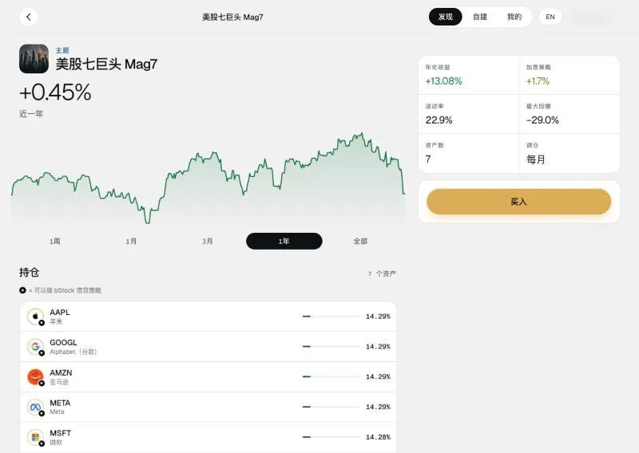
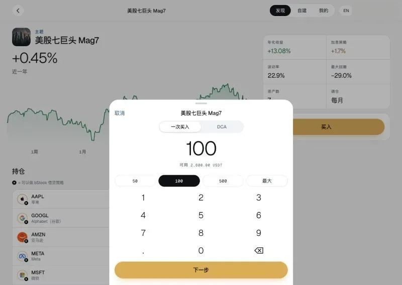
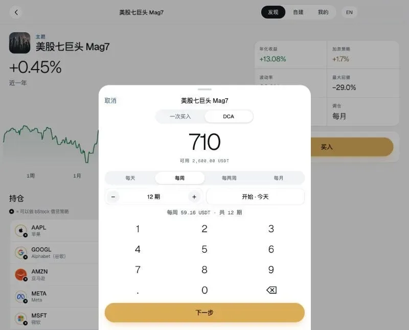
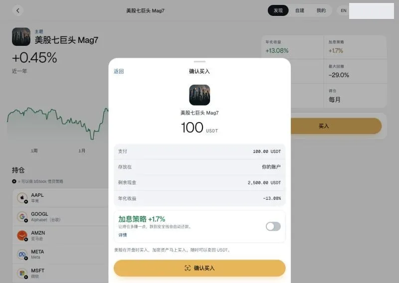
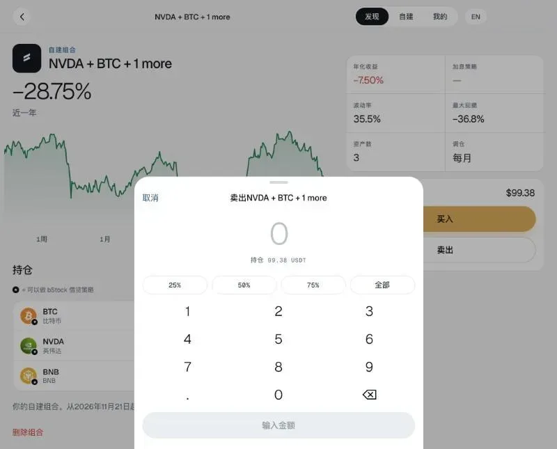

# 怎么用 CRE8 买第一个组合：从登录到买入

作者：CRE8 · 2026 年 11 月 23 日 · 阅读约 8 分钟

在 CRE8 买第一个组合，一共六步：加入等候名单拿邀请码，用邀请码和 X 账号登录，领免费的测试 USDT，选一个组合，输入金额（最少 50 USDT）后确认，之后随时可以卖回 USDT 并提走。整个过程只用 U，不用自己去 DEX 一只一只换。CRE8 目前只在 BNB Chain 测试网，用的是测试 USDT，不涉及真钱。

## 开始前要知道哪几个词？

CRE8 是 BNB Chain 上的应用，用 USDT 一次买入美股代币和加密资产组合，资产放在你自己的智能账户里，还能开启加息策略，让 bStock 多赚一份收益。

**智能账户**是 CRE8 在 BNB Chain 上为你开的链上账户，所有人是你登录用的钱包。资产就放在里面，不和别人的混在一起，转出必须你本人签名（[CRE8 使用指南](https://cre8.finance/zh/how-it-works)）。

bStock 是币安关联公司 BTech Holdings 在 BNB Chain 上发行的美股代币，每枚由托管的正股 1:1 支撑。币安官方写明「bStocks 不是股票」，分红先扣 30% 美国预扣税再折成代币（[Binance Learn](https://www.binance.com/en/learn/bstocks)）。

组合就是一篮按固定比例配好的资产，比如美股七巨头 7 只各约 14.3%。gas 是链上每笔交易要付的网络手续费，测试网上由 CRE8 出。

## 第一步：怎么拿到测试网的邀请码？

测试网是邀请制，先去 [cre8.finance/zh/waitlist](https://cre8.finance/zh/waitlist) 加入等候名单。页面会请你连接 X 账号、关注 @CRE8Finance；另外有几个可选的加分任务，比如发帖提到 @CRE8Finance、回答几个小问题、加入 Telegram 社群。

已经有邀请码的话，等候名单页上有「有邀请码？」的入口，可以直接去测试网。测试网应用的网址是 [tst.cre8.finance](https://tst.cre8.finance)，没有其他网址，看到别的域名不要登录。

## 第二步：怎么登录？

第一次登录要输入邀请码，再连接 X 账号；开通之后，也可以用 X、Google 或邮箱登录。登录后，CRE8 会在 BNB Chain 上为你开一个只属于你的智能账户（[CRE8 使用指南](https://cre8.finance/zh/how-it-works)）。

测试网登录需要邀请码。

逛组合、看持仓和历史走势不用登录，在官网的[组合页](https://cre8.finance/zh/portfolios)就能看。

## 第三步：账户里的 USDT 从哪来？

测试网上可以在应用里免费领测试 USDT。测试 USDT 只在测试网有用，没有真实价值，也不能换成真钱。

领到以后，USDT 就在你自己的智能账户里。还没投出去的这部分可以放着不动，也可以点 Earn 存进白名单里的 USDT 金库（Lista、Venus、Aave），随存随取。你不点，CRE8 不会动你的现金。测试网上的金库和利率都是模拟的。想了解这部分，看[闲置 USDT 怎么生息](/zh/blog/earn-yield-on-usdt-and-bstock)。

## 第四步：组合怎么挑？

CRE8 有 21 个精选组合，分三类：人物（佩洛西、特朗普、段永平、马斯克）、主题 15 个、杠杆 2 个（3 倍半导体、3 倍纳指）。每个组合页都公开成分、权重和模型年化。

模型年化是用现在的权重套历史价格算出来的回测，不是实盘战绩。比如[美股七巨头](https://cre8.finance/zh/portfolios/mag7)的模型年化是 +13.1%，[AI 芯片](https://cre8.finance/zh/portfolios/ai-chips)是 +61.4%，都是截至 2026 年 11 月 22 日的回测（[CRE8 llms.txt](https://cre8.finance/llms.txt)，2026-11-23 查询）。数字高的组合，跌起来通常也更猛。

第一次用，可以先挑一个你认得名单的组合，比如七巨头，看懂流程再说。不想用现成的，也可以自己挑股票、定比例，CRE8 一样帮你调仓，做法见[自己配组合](/zh/blog/build-your-own-portfolio)。

## 第五步：金额怎么填，一次买还是定投？

在组合页输入金额后确认。每笔最少 50 USDT。确认一次，CRE8 会按目标权重把整个组合买齐，不用你一只一只下单。

这里有两种买法可以选：

一次买入：整笔 U 马上按权重买进组合。

DCA（定投）：先把一笔 U 存进这个组合的账户，每期自动买一份，频率可选每天、每周、每两周、每月，每期最少 10 USDT。还没买的部分在等待期间会生息。细节见[用 USDT 定投美股](/zh/blog/dca-us-stocks-with-usdt)。

确认前还可以选择要不要打开加息策略，它默认关闭。打开后，CRE8 会把这个组合的股票存进借贷市场做抵押，按保守比例借出一小笔 USDT 存进 USDT 金库；价格跌到安全线时，系统自动用金库的 USDT 还一部分借款，不卖股票。随时可以关。风险很低，但不是零。杠杆组合不提供加息策略（[CRE8 使用指南](https://cre8.finance/zh/how-it-works)）。

第一次买，可以先不开，熟悉之后再说。

## 第六步：确认后会发生什么？

确认后，交易只走白名单里的链上 DEX（PancakeSwap、KyberSwap、OpenOcean）。每个资产有单笔上限，大单会自动拆成几笔成交（[CRE8 使用指南](https://cre8.finance/zh/how-it-works)）。

如果美股正在休市，股票代币不会成交。你的单会在账户里排队，下次开盘时成交；在那之前，USDT 一直留在你自己的账户里。

买进以后，组合会自动维持比例：精选组合每月调仓一次，任何资产偏离目标权重超过 5 个百分点时也会调。调仓是什么意思，[一次买一篮美股](/zh/blog/buy-us-stock-basket-with-usdt)那篇有完整例子。

## 用 100 U 走一遍是什么样？

假设你领了测试 USDT，想用 100 U 买美股七巨头。

七巨头的权重是苹果、谷歌、亚马逊、Meta 各 14.29%，微软、英伟达、特斯拉各 14.28%（[CRE8 llms.txt](https://cre8.finance/llms.txt)）。在组合页输入 100，确认一次，苹果、谷歌、亚马逊、Meta 各分到 14.29 U，微软、英伟达、特斯拉各分到 14.28 U，合计 100 U。实际拿到的 bStock 数量按成交价算，池子手续费和滑点会让它和整数略有差别。

如果你是在周六下的单，美股休市，这 100 U 会先留在账户里，等周一美股开盘才成交。

换成在交易所自己买同样一篮，就是下 7 单，每单金额自己算；币安单只 bStock 最低约 5 美元（[Binance Learn](https://www.binance.com/en/learn/bstocks)）。之后比例跑掉，也要自己算、自己调。

如果改用 DCA：比如存 500 U，每周买 50 U，分 10 期买完。第一周买进 50 U 的七巨头，剩下 450 U 在等待期间生息，第二周再买 50 U，以此类推。

测试网上的价格是模拟的，这些数字只用来说明流程。

## 之后怎么卖、怎么提走？

组合可以部分或全部卖回 USDT，钱回到你的账户。之后可以把 USDT 提到任意 BNB Chain 地址，包括交易所的充值地址（[CRE8 使用指南](https://cre8.finance/zh/how-it-works)）。

大额卖出会按每个资产的单笔上限分几笔成交。休市时卖股票代币，一样要等下次开盘。

提走 USDT 要你本人签名，CRE8 的自动化只能在你的账户里交易，转不出去。测试网上的 USDT 没有真实价值，提到交易所也不能用；这一步在主网上才有实际意义。

## 和其他买法比，第一次上手差在哪？

| | 交易所逐只买 bStock | 自己在链上逐只买 | CRE8（测试网） |
|---|---|---|---|
| 要准备什么 | 交易所账户 | 自己的钱包、助记词、BNB 付 gas | 邀请码和 X 账号 |
| 买一篮要下几单 | 一只一单 | 一只换一次 | 一笔 USDT 买齐 |
| 比例谁算 | 自己算 | 自己算 | 组合页公开；也可以自己配 |
| 资产放哪 | 交易所账户 | 自己的钱包 | 自己的智能账户 |
| 最低金额 | 单只约 5 美元 | 看 gas | 每笔 50 USDT；DCA 每期 10 USDT |
| 什么时候成交 | 24 小时 | 看 DEX 池子 | 股票代币只在美股交易时段 |
| 之后比例跑掉 | 自己调 | 自己调 | 自动调仓 |
| 目前状态 | 正式上线 | 正式上线 | BNB Chain 测试网，不涉及真钱 |

资料查询日：2026-11-23。币安数据见 [Binance Learn](https://www.binance.com/en/learn/bstocks)。

## 什么情况用别的方法就好？

只想买一两只股票：在币安直接下单最快，单只约 5 美元起，用不着组合。

要 24 小时随时成交：币安现货 24 小时都能交易，CRE8 的股票代币只在美股交易时段成交。

现在就想用真钱买：CRE8 还没上主网，主网日期未定。

在美国：CRE8 只对美国以外、当地法规允许的用户开放。

## 有哪些风险？

价格会跌。组合分散的是单只股票的风险，不是整个市场的风险，美股一起跌时组合也会跌。

模型年化不是承诺。它是回测，换一个时间段数字会差很多。测试网上的余额也是按模拟价格变动。

bStock 不是股票。你持有的是发行方的凭证，权利和在券商名下持股不同（[Binance Learn](https://www.binance.com/en/learn/bstocks)）。

加息策略的风险很低，但不是零；测试网上的金库和利率都是模拟的。

智能合约风险。CRE8 用智能合约运作，上主网前会做第三方合约审计，目前还没完成。

## 常见问题

### 没有邀请码能用吗？

不能登录测试网应用，但可以先在官网看所有组合的成分和走势。加入[等候名单](https://cre8.finance/zh/waitlist)后等邀请。

### 要先装钱包吗？

第一次用邀请码加 X 账号登录，之后也能用 Google 或邮箱，CRE8 会在 BNB Chain 上为你开智能账户。

### 测试网收费吗？

全免费，gas 也由 CRE8 付。主网费率会在上线前公布。

### 买了以后能改成别的组合吗？

可以把原组合部分或全部卖回 USDT，再用这笔 U 买别的组合。每个组合的钱分开，不会混在一起。

### CRE8 有发币吗？

没有。CRE8 目前没有发行代币，和 Solana 上的 CRE8 Finance 或任何 CRE8 代币都没有关系。

## 下一步

先加入[等候名单](https://cre8.finance/zh/waitlist)，拿到邀请码就能用测试 USDT 走一遍。

---

资料来源（查询日期 2026-11-23）：[CRE8 使用指南](https://cre8.finance/zh/how-it-works)、[CRE8 等候名单](https://cre8.finance/zh/waitlist)、[CRE8 llms.txt](https://cre8.finance/llms.txt)、[CRE8 美股七巨头组合页](https://cre8.finance/zh/portfolios/mag7)、[CRE8 AI 芯片组合页](https://cre8.finance/zh/portfolios/ai-chips)、[Binance Learn：bStocks](https://www.binance.com/en/learn/bstocks)。

本文只说明 CRE8 测试网怎么操作，不是投资建议。
