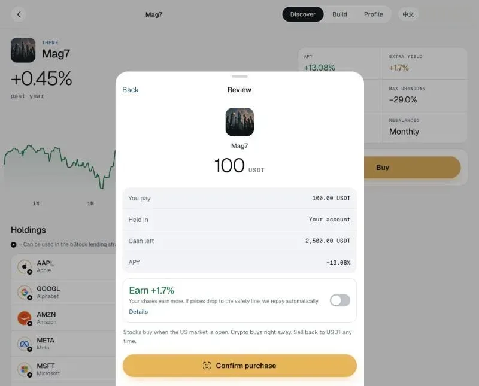

# Is CRE8 Safe? Custody, Permissions and Risks

By CRE8 · November 23, 2026 · About 8 minutes

Assets you buy on CRE8 sit in your own smart account on BNB Chain. CRE8's automation can only trade inside that account, and moving anything out takes your signature. Risks remain: smart contracts can fail, bStock holders depend on the issuer, prices fall, and yield strategy rates change. CRE8 is on testnet only, with no real money involved, and its contracts get an external audit before mainnet that hasn't been completed yet.

## What do the key terms mean?

A smart account is an on-chain account on BNB Chain that CRE8 opens for each user, owned by the wallet you signed in with. It isn't an exchange account. Your assets sit in it as tokens, and any block explorer can show them ([CRE8 How it works](https://cre8.finance/how-it-works)).

A signature is your wallet's approval of a specific action. Without your signature, assets can't leave your account.

A smart contract is a program on a blockchain that runs by preset rules. CRE8's accounts, the vaults and the lending markets are all smart contracts.

bStock is a tokenized US stock on BNB Chain, issued by BTech Holdings, a Binance affiliate. Each token is backed 1:1 by shares held with a custodian, and the issuer publishes a daily proof of collateral. Binance states that bStocks are not shares ([Binance Learn](https://www.binance.com/en/learn/bstocks)).

## Where are your assets held?

In your own smart account. Every user has a separate smart account on BNB Chain, and your assets are never pooled with anyone else's.

You can look up the account on a block explorer at any time and see which tokens it holds and how many. What a portfolio bought, and what each rebalance changed, is on-chain.

## Who can move your assets?

Only you can move assets out of the account. CRE8's automation has a narrow job: buying, selling and rebalancing inside your account, and running the Earn deposits and yield strategy you turned on. Moving anything out of the account takes your signature ([CRE8 How it works](https://cre8.finance/how-it-works)).

Cash works the same way. CRE8 never moves your USDT unless you press Earn. When you withdraw, you can send USDT to any BNB Chain address, including an exchange deposit address, and that step needs your signature.

## How does CRE8 limit how trades are made?

Three rules control how the automation trades.

First, allowlisted venues only. Trades go through PancakeSwap, KyberSwap and OpenOcean, which are decentralized exchanges (DEXs) where tokens swap against on-chain liquidity pools. Your assets aren't sent anywhere else to be traded.

Second, a per-trade cap on each asset. Large orders are split into several trades, so a single order doesn't push the price as far in a thin market.

Third, no forced trades outside market hours. Stock tokens only trade while the US market is open. An order placed while it's closed waits in your account until the next open, and your USDT stays in your account until then.

## Why are cash and each portfolio kept separate?

So a problem in one place doesn't spill into the rest. On CRE8, your cash, each portfolio's money and the USDT a yield strategy borrows are always tracked separately and never mixed.

USDT that a portfolio's yield strategy borrows belongs to that portfolio only. It never counts as your cash and never mixes with another portfolio. If one portfolio hits its safety line and has to repay, only that portfolio's own vault USDT is used.

## What protects the yield strategy?

The yield strategy is an option you can turn on when buying a portfolio. It uses the portfolio's shares as collateral to borrow a small amount of USDT, which earns interest in a vault. Four safeguards apply ([CRE8 How it works](https://cre8.finance/how-it-works)):

| Safeguard | How it works |
|---|---|
| Off by default | Nothing is pledged or borrowed unless you switch it on |
| Small, conservative loan | CRE8 borrows only a small part of what the market would allow |
| Automatic repayment at the safety line | The system repays part of the loan from that portfolio's vault USDT without selling your shares, and your activity log shows how much was repaid |
| Off any time | Switch it off and the shares stay in the portfolio |

Leveraged portfolios don't offer the yield strategy. These safeguards keep the risk low but can't remove it, as the risks section below explains.

## How does this compare with an exchange or your own wallet?

| | On an exchange (e.g. Binance) | In your own wallet | CRE8 smart account (testnet) |
|---|---|---|---|
| Where assets sit | Exchange account | Your own on-chain address | Your own on-chain smart account |
| Who can move them out | You, through an exchange withdrawal | Only you | Only you, with your signature |
| What the platform can do | Binance reserves the right to restrict accounts | There's no platform | Its automation can only trade inside your account |
| Who places trades | You, order by order | You, on a DEX | The system, by fixed rules, only through allowlisted DEXs |
| Earning | A separate earn product | Lending protocols, where you watch liquidation yourself | Earn and the yield strategy, with automatic repayment at the safety line |
| Main risks | Platform risk | Losing your keys, fake tokens, liquidation | Smart contracts, issuer, prices, rates |
| Status | Live | Live | Testnet, no real money |

Data checked November 23, 2026. Binance's account restriction terms are on [Binance Learn](https://www.binance.com/en/learn/bstocks); for fake look-alike tokens on-chain, see [DEXTools](https://www.dextools.io/news/xstocks-on-bnb-chain-the-reality-of-245-trading).

An exchange is simple to use and has customer support. Your own wallet gives you the most freedom, but every step is on you. CRE8 sits in between: the assets are in your own on-chain account, and trading and rebalancing follow fixed rules.

## Where does 1,000 USDT sit on CRE8?

Say you claim 1,000 test USDT on testnet. You press Earn on 300, put 700 into the Mag7 portfolio and switch on the yield strategy.

The 300 USDT earns in an Earn vault. It's your cash, and you can withdraw it any time.

The 700 USDT buys all seven stocks at their weights: about 100.03 USDT each in Apple, Alphabet, Amazon and Meta, and about 99.96 USDT each in Microsoft, NVIDIA and Tesla (weights from [CRE8 llms.txt](https://cre8.finance/llms.txt)). The bStock tokens sit in your smart account.

With the yield strategy on, those shares go into a lending market as collateral, and a small amount of USDT is borrowed into the Mag7 portfolio's own vault. That USDT belongs to the Mag7 portfolio only and isn't counted as part of your 300 USDT of cash.

If the stocks fall hard and hit the safety line, the system takes USDT from the Mag7 vault and repays part of the loan. None of the seven stocks are sold, and your 300 USDT of cash isn't touched.

To take everything out, sell the portfolio back to USDT while the US market is open. The money lands in your account, and you withdraw it to the BNB Chain address you choose, with your signature. On testnet, prices, vaults and rates are simulated, so the numbers are illustrations.

## What are the risks?

Smart contract risk. CRE8's accounts and automation, the Lista, Venus and Aave vaults, and the lending markets are all smart contracts, which can have bugs or be attacked. CRE8's contracts get an external audit before mainnet; it isn't done yet.

bStock issuer risk. bStock is not a share. You hold a certificate issued by BTech Holdings, and your rights depend on the issuer and custodian. Dividends arrive as extra tokens after a 30% US withholding tax, not as cash ([Binance Learn](https://www.binance.com/en/learn/bstocks)).

Price risk. Stocks and crypto fall as well as rise, and you can lose money. Model APY is a backtest and doesn't predict future returns. Some on-chain pools are thin, so large orders move the price.

Lending rate risk. Vault yield comes from interest paid by borrowers, and rates change, sometimes to near zero. The yield strategy adds one more layer: the borrowing rate can rise above the vault rate, shrinking the extra yield to nothing. CRE8 doesn't promise any rate.

Testnet stage. CRE8 runs on BNB Chain testnet with test tokens and simulated prices. No real money is involved, and there's no mainnet date yet. Working on testnet doesn't guarantee that everything will be identical on mainnet.

## Has CRE8 been audited?

Not yet. CRE8's contracts get an external audit before mainnet. Until then, CRE8 runs only on testnet with free test USDT.

## When is another option the better fit?

You're used to an exchange and want customer support if something goes wrong. For one or two stocks, buying bStock directly on Binance is simplest.

You know DeFi and want to decide how much to borrow, where to deposit and how each swap is made. Running your own wallet gives you that control, along with all of the monitoring.

You want real shares with full shareholder rights. bStock is a certificate, so that calls for an overseas brokerage account.

You want to use real money now. CRE8 is testnet only.

## FAQ

**Can CRE8 move my money out?**
No. CRE8's automation can only trade inside your account, and moving assets out takes your signature.

**Will CRE8 touch my cash?**
Not unless you press Earn. Cash you leave alone stays in your account.

**Will the yield strategy sell my shares?**
No. At the safety line, the system repays from that portfolio's vault USDT, and the shares aren't sold.

**If one portfolio has a problem, does it affect the others?**
No. Cash and each portfolio's money are kept separate, and USDT borrowed by a yield strategy belongs only to that portfolio.

**Are the contracts audited?**
Not yet. An external audit comes before mainnet.

**Can I lose real money right now?**
No. Testnet uses free test USDT, and no real money is involved.

## Next step

For the full rules on buying, custody, fees and withdrawals, read [How CRE8 works](https://cre8.finance/how-it-works).

---

Further reading: [What is CRE8?](/blog/what-is-cre8), [Can you self-custody US stock tokens on BNB Chain?](/blog/buy-tokenized-stocks-on-bnb-chain), [How to earn yield on idle USDT and bStock](/blog/earn-yield-on-usdt-and-bstock)

Sources (checked November 23, 2026): [CRE8 How it works](https://cre8.finance/how-it-works), [CRE8 llms.txt](https://cre8.finance/llms.txt), [Binance Learn: bStocks](https://www.binance.com/en/learn/bstocks), [DEXTools](https://www.dextools.io/news/xstocks-on-bnb-chain-the-reality-of-245-trading).

This article is not investment advice.
