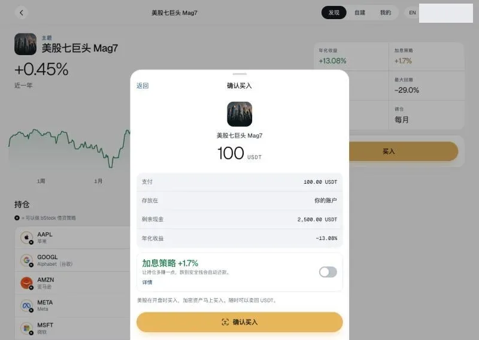

# CRE8 安全吗？资产放在哪、谁能动、有哪些风险

作者：CRE8 · 2026 年 11 月 23 日 · 阅读约 8 分钟

在 CRE8 买的资产放在你自己的 BNB Chain 智能账户里，CRE8 的自动化只能在账户里交易，资产要转出必须你本人签名。风险依然存在：智能合约可能出错，bStock 的权利取决于发行方，价格会跌，加息策略的利率会变。CRE8 目前只在测试网上，不涉及真钱；上主网前会做第三方合约审计，目前还没完成。

## 先说清楚几个词

智能账户是 CRE8 在 BNB Chain 上为每个用户单独开的链上账户，所有人是你登录用的钱包。它不是交易所账户，资产以代币形式放在里面，用任何区块浏览器都查得到（[CRE8 使用指南](https://cre8.finance/zh/how-it-works)）。

签名是你用自己的钱包确认一笔操作。没有你的签名，资产转不出账户。

智能合约是部署在区块链上、按写好的规则自动执行的程序。CRE8 的账户、金库、借贷市场都是智能合约。

bStock 是币安关联公司 BTech Holdings 在 BNB Chain 上发行的美股代币，每枚由托管的正股 1:1 支撑，发行方每天公布抵押证明。币安官方写明「bStocks 不是股票」（[Binance Learn](https://www.binance.com/en/learn/bstocks)）。

## 资产放在哪？

放在你自己的智能账户里。每个用户在 BNB Chain 上都有自己的智能账户，资产不和别人的混在一起。

你可以随时用区块浏览器看到账户里有哪些代币、各有多少。组合买了什么、调仓换了什么，都是链上记录。

## 谁能动你的资产？

能决定资产离开账户的只有你。CRE8 的自动化有权限做的事情很窄：在你的账户里买入、卖出、调仓，以及执行你打开的 Earn 和加息策略。资产要转出账户，必须你本人签名（[CRE8 使用指南](https://cre8.finance/zh/how-it-works)）。

现金也一样。你不点 Earn，CRE8 不会动你账户里的 USDT。提现时，你可以把 USDT 提到任意 BNB Chain 地址，包括交易所充值地址，这一步要你签名。

## 交易怎么避免出错？

CRE8 用三条规则限制自动化怎么交易。

第一，只走白名单 DEX。交易只通过 PancakeSwap、KyberSwap 和 OpenOcean 这三个链上交易场所，不会把你的资产拿去别的地方换。DEX 是去中心化交易所，直接和链上资金池交换代币。

第二，每个资产有单笔上限。大单会自动拆成几笔成交，减少一次买太多把价格推高。

第三，休市不硬买硬卖。股票代币只在美股交易时段成交，休市时下的单在账户里排队，下次开盘时成交，在那之前 USDT 留在你自己的账户里。

## 现金和各个组合的钱为什么要分开？

为了让一个地方出状况时，不拖累其他的钱。在 CRE8，你的现金、每个组合的资金、加息策略借来的 USDT 永远分开记账，互不混用。

加息策略借来的 USDT 只属于那个组合。它不算你的现金，也不会和别的组合混在一起。一个组合跌到安全线要还款，动用的只是这个组合自己金库里的 USDT。

## 加息策略有哪些保护？

加息策略是买组合时可以打开的选项，用组合里的股票抵押，借一小笔 USDT 存进金库赚利息。它有四层保护（[CRE8 使用指南](https://cre8.finance/zh/how-it-works)）：

| 保护 | 怎么做 |
|---|---|
| 默认关闭 | 不打开就不会抵押、不会借款 |
| 只借一小部分 | 只借市场允许额度的一小部分，按保守比例 |
| 跌到安全线自动还款 | 系统用这个组合金库里的 USDT 还掉一部分借款，股票不卖，事后在活动记录里告诉你还了多少 |
| 随时可关 | 关掉后股票留在组合里 |

杠杆组合不提供加息策略。这些保护让风险很低，但不是零，下面风险段会写清楚。

## 和放交易所、放自己钱包比，差在哪？

| | 放在交易所（如币安） | 放在自己的钱包 | CRE8 智能账户（测试网） |
|---|---|---|---|
| 资产在谁那里 | 交易所账户 | 你自己的链上地址 | 你自己的链上智能账户 |
| 谁能转出资产 | 你在交易所操作提币 | 只有你 | 只有你，转出要本人签名 |
| 平台能做什么 | 币安保留限制账户的权利 | 没有平台 | 自动化只能在账户里交易 |
| 交易谁来做 | 你自己下单 | 你自己在 DEX 操作 | 系统按规则买入、调仓，只走白名单 DEX |
| 生息 | 另外买理财产品 | 自己去借贷协议，清算自己盯 | Earn 和加息策略，跌到安全线自动还款 |
| 主要风险 | 平台风险 | 私钥丢失、买到假币、清算 | 智能合约、发行方、价格、利率 |
| 目前状态 | 正式运行 | 正式运行 | 测试网，不涉及真钱 |

资料查询日期：2026-11-23。币安限制账户的条款见 [Binance Learn](https://www.binance.com/en/learn/bstocks)；链上同名假币的情况见 [DEXTools](https://www.dextools.io/news/xstocks-on-bnb-chain-the-reality-of-245-trading)。

放交易所的好处是操作简单、出问题能找客服。放自己钱包最自由，但每一步都要自己做对。CRE8 介于两者之间：资产在你自己的链上账户，交易和调仓由系统按固定规则做。

## 1,000 USDT 放进 CRE8，钱分别在哪？

假设你在测试网领了 1,000 测试 USDT：300 点 Earn，700 买美股七巨头组合，并打开加息策略。

300 USDT 在 Earn 金库里生息，随时可以领回，它属于你的现金。

700 USDT 按权重买齐 7 只股票：苹果、谷歌、亚马逊、Meta 各约 100.03 USDT，微软、英伟达、特斯拉各约 99.96 USDT（权重见 [CRE8 llms.txt](https://cre8.finance/llms.txt)）。这些 bStock 放在你的智能账户里。

加息策略打开后，这些股票存进借贷市场当抵押，借出一小笔 USDT 存进这个组合自己的金库。这笔 USDT 只属于七巨头组合，不算进你的 300 USDT 现金。

如果股价大跌碰到安全线，系统从七巨头组合的金库里拿 USDT 还掉一部分借款。7 只股票不卖，你的 300 USDT 现金也不受影响。

想全部拿走时，先在美股开盘时把组合卖回 USDT，钱回到你的账户，再把 USDT 提到你指定的 BNB Chain 地址，这一步要你签名。测试网上的价格、金库和利率都是模拟的，数字只能当示意。

## 有哪些风险？

智能合约风险。CRE8 的账户和自动化、Lista、Venus、Aave 的金库、借贷市场都是智能合约，合约可能出错或被攻击。CRE8 上主网前会做第三方审计，目前还没完成。

bStock 发行方风险。bStock 不是股票本身，你持有的是 BTech Holdings 发行的凭证，权利取决于发行方和托管方。分红先扣 30% 美国预扣税，再折成更多代币，不发现金（[Binance Learn](https://www.binance.com/en/learn/bstocks)）。

价格风险。股票和加密资产都会跌，可能亏钱。组合的模型年化是回测，不代表以后。部分资产的链上池子较浅，大额买卖会有滑点。

借贷利率风险。金库的收益来自借款人付的利息，利率会变，可能接近零。加息策略还多一层：借款利率可能高过金库利率，收益变少甚至没有。CRE8 不承诺任何收益率。

测试网阶段。CRE8 现在跑在 BNB Chain 测试网上，代币和价格都是测试版，不涉及真钱，主网上线时间还没定。测试网能用，不代表主网上线时一切都一样。

## 审计做了吗？

还没有。CRE8 会在上主网前做第三方合约审计，审计完成前只在测试网运行，用的是免费的测试 USDT。

## 什么情况用别的方法就好？

你更习惯交易所，出问题想直接找客服。只买一两只股票的话，在币安直接买 bStock 最省事。

你懂 DeFi，想自己决定借多少、存哪里、每一笔怎么换。自己用钱包操作更灵活，代价是每一步风险都要自己盯。

你想要真股票和完整的股东权利。bStock 是凭证，这种需求要开海外券商账户。

你现在就想用真钱。CRE8 目前只有测试网。

## 常见问题

**CRE8 能把我的钱转走吗？**
不能。CRE8 的自动化只能在你的账户里交易，资产转出账户必须你本人签名。

**CRE8 会动我的现金吗？**
不会，除非你自己点 Earn。现金放着不动，就一直在你的账户里。

**加息策略会卖掉我的股票吗？**
不会。跌到安全线时，系统用这个组合金库里的 USDT 还款，股票不卖。

**一个组合出问题，会影响别的组合吗？**
不会。现金和每个组合的资金分开记账，加息策略借来的 USDT 只属于那个组合。

**合约审计了吗？**
还没有。上主网前会做第三方审计。

**现在用会亏真钱吗？**
不会。测试网用的是免费的测试 USDT，不涉及真钱。

## 下一步

想看完整的买入、托管、费用和提现规则，读 [CRE8 使用指南](https://cre8.finance/zh/how-it-works)。

---

延伸阅读：[CRE8 是什么](/zh/blog/what-is-cre8)、[美股代币能放自己钱包吗](/zh/blog/self-custody-us-stock-tokens-bnb-chain)、[闲置 USDT 怎么生息](/zh/blog/earn-yield-on-idle-usdt-and-bstock)。

资料来源（查询日期 2026-11-23）：[CRE8 使用指南](https://cre8.finance/zh/how-it-works)、[CRE8 llms.txt](https://cre8.finance/llms.txt)、[Binance Learn：bStocks](https://www.binance.com/en/learn/bstocks)、[DEXTools](https://www.dextools.io/news/xstocks-on-bnb-chain-the-reality-of-245-trading)。

本文只是说明产品的保管方式和风险，不是投资建议。
