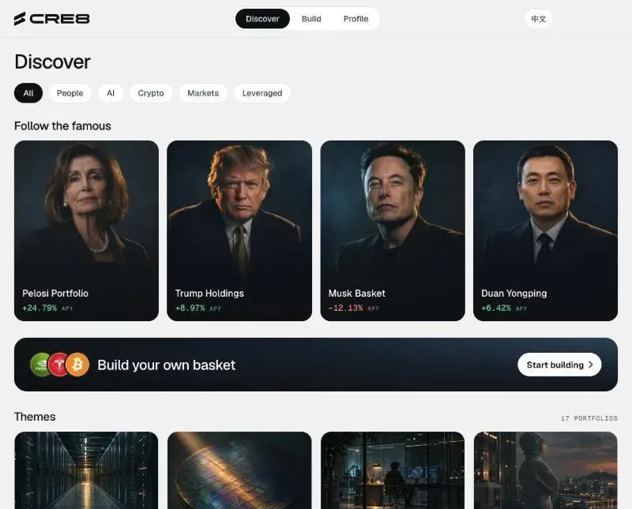

# What Is CRE8? Buy a Basket of US Stocks and Crypto With USDT

By CRE8 · November 23, 2026 · About 8 minutes

CRE8 (cre8.finance) is an app on BNB Chain for buying baskets of tokenized US stocks and crypto with USDT, held in your own smart account, with yield strategies that put your bStock to work. After you buy, each portfolio rebalances automatically to keep its target weights. As of November 23, 2026, CRE8 runs only on BNB Chain testnet: no real money is involved, signing in needs an invite code, and CRE8 has no token.

## What do the key terms mean?

bStock is a tokenized US stock on BNB Chain, issued by BTech Holdings, a Binance affiliate. Each token is backed 1:1 by shares held with a custodian, the issuer publishes a daily proof of collateral, and the price tracks the underlying stock. Binance states that bStocks are not shares, and dividends arrive as extra tokens after a 30% US withholding tax rather than as cash ([Binance Learn](https://www.binance.com/en/learn/bstocks)).

A smart account is an on-chain account on BNB Chain that CRE8 opens for each user. Your assets sit in it, never pooled with anyone else's. CRE8's automation can only trade inside it, and moving anything out takes your signature.

A portfolio is a basket of assets at fixed target weights, for example seven big US tech stocks at about 14.3% each. CRE8 has 21 ready-made portfolios, and you can also build your own.

Rebalancing means trimming what has grown and topping up what has shrunk, so the basket goes back to its target weights after prices move.

## What can you do with CRE8?

In short: one USDT payment buys a whole basket, the assets stay in your own account, the weights maintain themselves, and idle USDT can earn. Here is the feature list ([CRE8 How it works](https://cre8.finance/how-it-works)):

| Feature | What it does |
|---|---|
| Buy a basket | Pick a portfolio, enter an amount, and one payment buys every asset at its target weight. Minimum 50 USDT per purchase |
| Ready-made portfolios | 21 in total: 4 people, 15 themes, 2 leveraged |
| Build your own | Choose your own assets and weights; CRE8 rebalances on the schedule you pick |
| Automatic rebalancing | Ready-made portfolios rebalance monthly, plus whenever an asset drifts more than 5 points from target |
| DCA | Deposit once; the part not yet invested earns while CRE8 buys in installments |
| Earn | Put idle USDT in allowlisted vaults (Lista, Venus, Aave) and withdraw any time |
| Yield strategy | Optional when you buy a portfolio; uses the portfolio's shares as collateral to borrow a small amount of USDT that earns in a vault. Off by default |
| Sell and withdraw | Sell some or all back to USDT, then withdraw to any BNB Chain address |

## How does CRE8 work?

### Buying

Sign in with your invite code and X account (after the first time, Google or email works too). CRE8 opens a smart account for you on BNB Chain that only you control. Add USDT, pick a portfolio, enter an amount and confirm once. The system buys every asset at its weight.

Trades go only through allowlisted on-chain venues: PancakeSwap, KyberSwap and OpenOcean. These are decentralized exchanges (DEXs), where tokens swap directly against on-chain liquidity pools instead of through an exchange account. Each asset has a per-trade cap, so large orders are split into several trades.

Stock tokens only trade during US market hours. An order placed while the market is closed waits in your account and goes through at the next open. Until then, your USDT stays in your own account.

### Custody

The tokens sit in your own smart account, where any block explorer can show them. CRE8's automation can only run trades inside your account, and moving anything out takes your signature. There's a separate post on this: [Is CRE8 safe?](/blog/is-cre8-safe)

### Rebalancing

Ready-made portfolios rebalance once a month. They also rebalance whenever an asset drifts more than 5 percentage points from its target weight. Say NVIDIA is meant to be 19% of a portfolio and grows to 25%: that triggers a rebalance, and the system sells some NVIDIA and tops up the other holdings.

If you build your own portfolio, you choose how often it rebalances: daily, weekly, monthly or quarterly.

### DCA

Dollar-cost averaging (DCA) means investing a fixed amount on a schedule instead of all at once, which spreads out your entry price. On CRE8, you deposit the total into the portfolio's account first. CRE8 then buys one installment daily, weekly, every two weeks or monthly, with a minimum of 10 USDT per installment. The money waiting to be invested sits in a USDT vault and earns. Leveraged portfolios can't be bought in installments. More in [How to DCA into US stocks with USDT](/blog/dca-us-stocks-with-usdt).

### Earn

USDT in your account can just sit there, or you can press Earn to put it in an allowlisted USDT vault (Lista, Venus or Aave). Each vault shows its APY, which follows market rates; CRE8 doesn't promise a rate. Withdraw any amount, interest included, whenever you like. CRE8 never moves your cash unless you ask it to.

### Yield strategy

When you buy a portfolio, you can switch on the yield strategy. It's off unless you turn it on. CRE8 then deposits the portfolio's shares in a lending market, borrows a small part of what the market would allow in USDT, and puts that USDT in a vault to earn interest. If prices fall to the safety line, the system automatically repays part of the loan from the vault, without selling your shares, and your activity log shows how much was repaid. You can switch it off at any time. Leveraged portfolios don't offer it.

Your cash, each portfolio's money and the USDT a yield strategy borrows are always kept apart. More in [How to earn yield on idle USDT and bStock](/blog/earn-yield-on-idle-usdt-and-bstock).

## What does 1,000 USDT look like on CRE8?

Say you claim 1,000 test USDT on testnet. You put 500 into the Mag7 portfolio and press Earn on the other 500.

The 500 USDT buys all seven stocks at the weights published in CRE8's llms.txt ([CRE8 llms.txt](https://cre8.finance/llms.txt)):

| Stock | Weight | Out of 500 USDT |
|---|---|---|
| Apple (AAPL) | 14.29% | 71.45 USDT |
| Microsoft (MSFT) | 14.28% | 71.40 USDT |
| Alphabet (GOOGL) | 14.29% | 71.45 USDT |
| Amazon (AMZN) | 14.29% | 71.45 USDT |
| NVIDIA (NVDA) | 14.28% | 71.40 USDT |
| Meta (META) | 14.29% | 71.45 USDT |
| Tesla (TSLA) | 14.28% | 71.40 USDT |

On an exchange, that's seven orders and your own math. On CRE8, it's one confirmation. After that, the portfolio rebalances monthly, and sooner if any stock drifts more than 5 points.

The other 500 USDT earns the vault rate in Earn, and you can take it back whenever you want. It's tracked separately from the Mag7 money. On testnet, prices, vaults and rates are simulated, there are no fees, and CRE8 pays the gas.

## How is CRE8 different from other ways to buy US stocks?

| | Stock tokens on an exchange (e.g. Binance) | Buy on a DEX from your own wallet | Overseas broker | CRE8 (testnet) |
|---|---|---|---|---|
| What you get | The issuer's stock token, e.g. bStock | Same | Real shares | A basket of bStock and crypto |
| Where assets sit | Exchange account; you can withdraw | Your own wallet | Brokerage account | Your own BNB Chain smart account |
| Pay with USDT | Yes | Yes | Usually fiat first | Yes |
| One purchase for a basket | No, one order per stock | No | Yes, via an ETF | Yes, one payment at target weights |
| Automatic rebalancing | No | No | No | Monthly, plus 5-point drift |
| Yield on idle cash | Separate earn product | Do it yourself in lending protocols | Cash interest | Earn, in the same account |
| Choice of assets | Close to 100 bStock on Binance | Depends on on-chain liquidity | Thousands | 21 ready-made portfolios, or build your own |
| Status | Live | Live | Live | Testnet, no real money |

Data checked November 23, 2026. The bStock count is from [Finance Magnates](https://www.financemagnates.com/cryptocurrency/exchange/binance-claims-fastest-1-billion-sprint-in-bstocks-with-6-billion-in-share-conversions/), which reported "close to 100" in October 2026.

## What stage is CRE8 at?

CRE8 runs on BNB Chain testnet (BSC testnet), with test versions of the tokens and simulated prices. Test USDT is free, and no real money is involved.

Signing in needs an invite code. The way in is the waitlist at [cre8.finance/waitlist](https://cre8.finance/waitlist); with a code, you sign in at tst.cre8.finance.

Testnet has no fees, and CRE8 pays the gas. Mainnet fees will be announced before launch, with DEX pool fees and slippage on top. There's no mainnet date yet. The contracts get an external audit before mainnet, and that audit isn't done yet.

Anyone outside the US can use CRE8, where local rules allow. CRE8 has no token.

## Is CRE8 related to CRE8 Finance on Solana?

No. The CRE8 in this post is an app on BNB Chain at cre8.finance, on X as [@CRE8Finance](https://x.com/CRE8Finance). It isn't related to the CRE8 Finance project on Solana or to any CRE8 token. CRE8 has no token at present, so any token calling itself CRE8 isn't ours.

## Who is CRE8 for?

People who hold USDT and want a basket of US stocks and crypto in one purchase. For example, someone with 1,000 USDT who wants all of the Mag7 without placing seven orders and doing the math.

People who want to hold their own assets without running DEX swaps and lending positions by hand. The assets sit in your own on-chain account, and the system handles trading and rebalancing by fixed rules.

People who want to DCA or earn on idle USDT. Money waiting for a DCA installment and spare cash can both earn in the same account.

## When is another option the better fit?

You only want one or two stocks. If you just want to turn 500 USDT into NVIDIA, buying the bStock on Binance is quickest.

You want real shares with full shareholder rights. bStock is the issuer's certificate; shares registered to you need an overseas brokerage account.

You want a huge selection. Binance Stocks offers more than 7,000 US stocks and ETFs ([The Block](https://www.theblock.co/amp/post/403155/binance-adds-us-stocks-etfs-traders-outside-united-states-super-app-push)). CRE8 only uses assets with enough on-chain liquidity.

You want futures or margin trading. CRE8 is spot only. Its two 3x portfolios hold leveraged ETF tokens, not futures contracts.

You're a US person, or you want to use real money today. CRE8 isn't available in the US, and it's testnet only for now.

## What are the risks?

Prices go down as well as up, and you can lose money. Model APY is a backtest of current weights on historical prices. It's not a track record and doesn't predict future returns.

bStock is not a share. You hold a certificate issued by BTech Holdings, and your rights depend on the issuer and custodian.

Smart contracts can have bugs. CRE8 and the vaults at Lista, Venus and Aave all run on smart contracts. CRE8's contracts get an external audit before mainnet.

The yield strategy is low risk, not no risk. Lending rates change, and the extra yield can shrink to nothing.

It's a testnet. Prices, vaults and rates are simulated, so treat testnet numbers as illustrations.

## FAQ

**Which blockchain is CRE8 on?**
BNB Chain (BSC). The testnet is BSC testnet.

**Can CRE8 take my money?**
No. Your assets are in your own smart account. CRE8's automation can only trade inside it, and withdrawals need your signature.

**What's the minimum?**
50 USDT per purchase, and 10 USDT per DCA installment.

**Does CRE8 charge fees?**
Not on testnet, and CRE8 pays the gas. Mainnet fees will be announced before launch.

**Does CRE8 have a token?**
No. It's also not the CRE8 Finance project on Solana.

**Where is it available?**
Outside the US, where local rules allow. For now you need an invite code to sign in to the testnet.

## Next step

See what each portfolio holds on the [All portfolios](https://cre8.finance/portfolios) page. For how the 21 portfolios are built, read [CRE8 portfolios explained](/blog/cre8-portfolios-explained).

---

Further reading: [What is bStock?](/blog/what-is-bstock), [Is CRE8 safe?](/blog/is-cre8-safe)

Sources (checked November 23, 2026): [CRE8 How it works](https://cre8.finance/how-it-works), [CRE8 llms.txt](https://cre8.finance/llms.txt), [Binance Learn: bStocks](https://www.binance.com/en/learn/bstocks), [Finance Magnates](https://www.financemagnates.com/cryptocurrency/exchange/binance-claims-fastest-1-billion-sprint-in-bstocks-with-6-billion-in-share-conversions/), [The Block](https://www.theblock.co/amp/post/403155/binance-adds-us-stocks-etfs-traders-outside-united-states-super-app-push).

This article is not investment advice.
